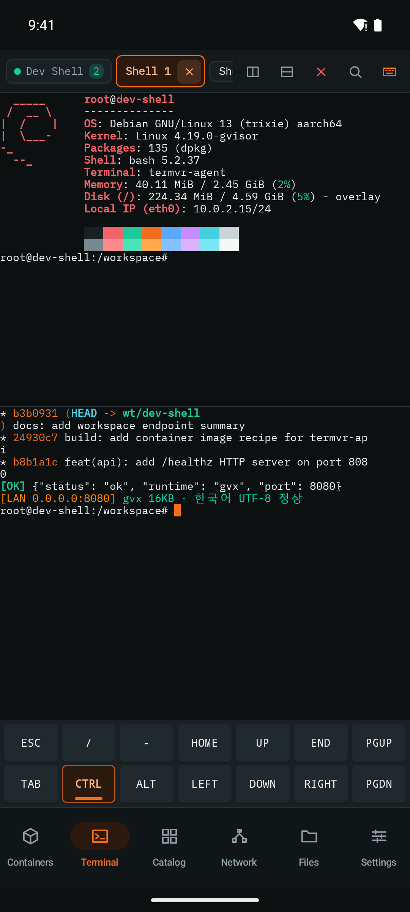

<p align="center">
  
</p>

<p align="center">
  <a href="https://github.com/gfire-sigs/TermVR/releases/latest">
    
  </a>
  <a href="https://github.com/gfire-sigs/TermVR/actions/workflows/ci.yml">
    
  </a>
  <a href="LICENSE">
    
  </a>
  
</p>

<p align="center">
  <strong><a href="https://github.com/gfire-sigs/TermVR/releases/latest">Download Latest APK</a></strong>
  &nbsp;&middot;&nbsp;
  <strong><a href="docs/releases/v0.16.10002026110900.md">Release Notes</a></strong>
  &nbsp;&middot;&nbsp;
  <strong><a href="https://github.com/gfire-sigs/TermVR-Fonts">TermVR Mono NF</a></strong>
</p>

`TermVR` runs standard `arm64` and `x86_64` OCI Linux containers on unrooted Android 12+ devices. The runtime executes Linux system calls inside the `gvx` user-space kernel (`systrap`). Terminal views render through `libghostty-vt` over OpenGL ES 3.0 with the bundled `TermVR Mono NF` font.

## Screenshots

<table>
  <tr>
    <td width="50%" align="center">
      
      <br>
      <sub>Debian 13 shell running <code>fastfetch</code> with touch modifier keys.</sub>
    </td>
    <td width="50%" align="center">
      
      <br>
      <sub>Container dashboard showing live CPU, memory, freeze, and stop controls.</sub>
    </td>
  </tr>
  <tr>
    <td width="50%" align="center">
      
      <br>
      <sub>Named <code>ext4lite</code> volume browser inspecting a persistent container root.</sub>
    </td>
    <td width="50%" align="center">
      
      <br>
      <sub>Port forwarding rules with <code>127.0.0.1</code> defaults, <code>0.0.0.0</code> confirmation, and QR link.</sub>
    </td>
  </tr>
</table>

## How it works

`TermVR` pulls OCI images matching your device CPU and boots them inside `gvx`. Debian 13 (`debian:trixie-slim`) is the default quick-launch image, alongside Ubuntu, Fedora, Alpine, `docker:dind`, and single-node `k3s` in `Catalog`. Containers start with uncapped CPU and memory unless you enter explicit limits.

One static guest multiplexer (`termvr-agent`) shares a single sandbox across all open tabs and split panes. That multiplexer keeps host child processes to at most 4 per running container. The terminal host uses one `SurfaceView`, a two-row touch key bar, and a composition buffer for Hangul and CJK soft keyboards.

Inbound port rules bind `127.0.0.1` by default. Exposing a port on `0.0.0.0` requires confirmation and applies through checkpoint and restore. You can also route outbound container traffic directly or through `HTTP`, `HTTPS`, `SOCKS5`, `SOCKS4`, or an imported WireGuard tunnel.

## Storage and snapshots

By default, a container runs on an in-memory root over read-only image layers, similar to `docker run --rm`. Stopping an ephemeral container discards changes outside `/workspace` and mounted volumes.

Check **Persistent root (`ext4lite`)** when creating a container if you want `apt` packages and `/etc` files to survive full stops. `TermVR` then allocates a `rootfs-<id>.ext4` image for `/`, lists it under `Files > Volumes`, and deletes it if you remove the container.

- `/workspace` connects to Android's Storage Access Framework (`SAF`) so external Android editors can open and save project files.
- Named `ext4lite` volumes attach at custom mount paths for databases, Docker data, or `k3s` cluster state.
- `Freeze` checkpoints live processes to disk and exits the sandbox process, and `Resume` restores open shells and background jobs.

## Install

Download the APK for your device architecture from [GitHub Releases](https://github.com/gfire-sigs/TermVR/releases/latest) and verify its digest against `SHA256SUMS`. Each `arm64-v8a` APK works on both 4 KB and 16 KB page-size kernels on Android 12 and newer.

| Release file | Target devices | Notes |
| :--- | :--- | :--- |
| `TermVR-<tag>-arm64-v8a.apk` | 64-bit ARM phones, foldables, and tablets | Supports 4 KB and 16 KB Android kernels. |
| `TermVR-<tag>-x86_64.apk` | 64-bit x86 tablets, Chromebooks, and emulators | Matches `linux/amd64` container images. |
| `SHA256SUMS` | All downloads | Contains SHA-256 digests for the release APKs. |

1. Install the APK matching your device architecture.
2. Open `TermVR` and tap `New Container`.
3. Enable **Persistent root (`ext4lite`)** if you want installed packages to survive container stops.
4. Tap `Create` and `Start` to pull the image and open a shell.
5. Tap `Freeze` on idle containers to save their state to disk.

> [!NOTE]
> Android kills background apps when system-wide child processes exceed 32. Enable `Disable child process restrictions` in Android Developer Options before running multiple containers at once.

## Build from source

`TermVR` builds from pinned upstream commits in [`scripts/source-lock.json`](scripts/source-lock.json) with zero proprietary SDKs or analytics libraries. Run these commands on Linux or macOS with JDK 17, Gradle `8.11.1`, and Android NDK `28.0.13004108` installed.

```bash
./scripts/provision-toolchains-and-vendor.sh
./scripts/build-native-deps.sh --abi arm64-v8a,x86_64
gradle :app:assembleRelease -PtermvrAbis=arm64-v8a,x86_64
```

Read [`CONTRIBUTING.md`](CONTRIBUTING.md) for offline F-Droid build rules and [`docs/designs/SITEMAP.md`](docs/designs/SITEMAP.md) for architecture documents.

## License

`TermVR` uses the [Apache License, Version 2.0](LICENSE). The bundled `TermVR Mono NF` font uses the SIL Open Font License 1.1 (`OFL-1.1`). You can read full third-party license notices offline under `Settings > Licenses`.
