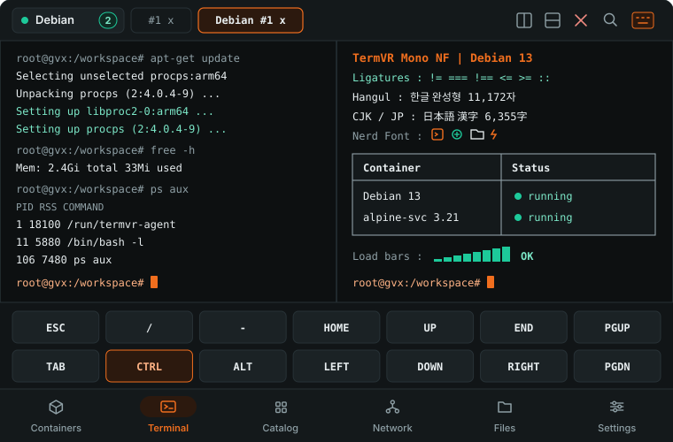
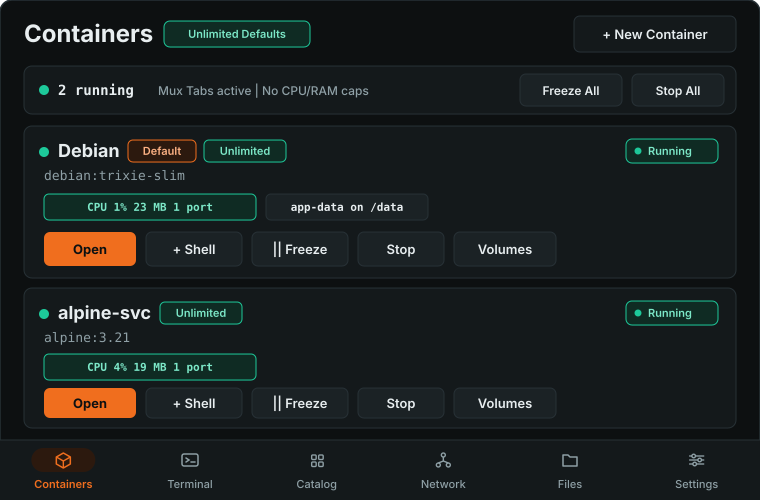
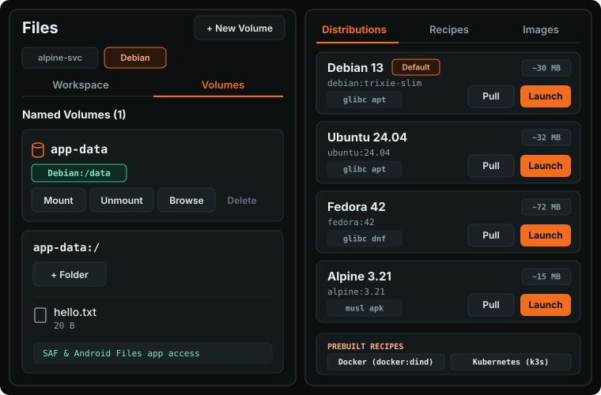
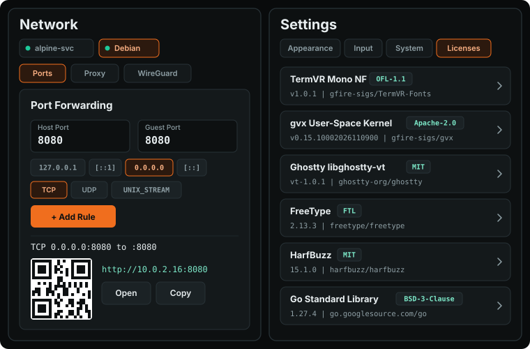

<p align="center">
  
</p>

<p align="center">
  <a href="https://github.com/gfire-sigs/TermVR/releases/latest">
    
  </a>
  <a href="https://github.com/gfire-sigs/TermVR/actions/workflows/ci.yml">
    
  </a>
  <a href="LICENSE">
    
  </a>
  
</p>

<p align="center">
  <strong><a href="https://github.com/gfire-sigs/TermVR/releases/latest">Download Latest APK</a></strong>
  &nbsp;&middot;&nbsp;
  <strong><a href="docs/releases/v0.15.10002026110900.md">Release Notes</a></strong>
  &nbsp;&middot;&nbsp;
  <strong><a href="https://github.com/gfire-sigs/TermVR-Fonts">TermVR Mono NF</a></strong>
</p>

`TermVR` runs real Linux containers and development tools on unrooted Android phones, foldables, and tablets. It pairs a user-space Linux runtime with a 120 Hz GPU terminal and touch controls.

---

## Gallery

Each screen keeps container status, files, and network rules visible without nested menus. Tap any card below to inspect the interface layouts across phones and tablets.

<table>
  <tr>
    <td width="50%" align="center">
      
      <br>
      <strong>120 Hz GPU Terminal and TermVR Mono NF</strong><br>
      <sub>Split panes, Hangul and CJK glyphs, ligatures, box-drawing tables, and a 2-row key bar.</sub>
    </td>
    <td width="50%" align="center">
      
      <br>
      <strong>Concurrent Multi-Container Control</strong><br>
      <sub>Run Debian 13 and Alpine side by side with unlimited defaults and one-tap Freeze.</sub>
    </td>
  </tr>
  <tr>
    <td width="50%" align="center">
      
      <br>
      <strong>Named Volumes and Distribution Catalog</strong><br>
      <sub>Browse ext4 volumes, edit workspace files in Android apps, and launch Debian, Ubuntu, Fedora, or Alpine.</sub>
    </td>
    <td width="50%" align="center">
      
      <br>
      <strong>Explicit Network Rules and Licenses</strong><br>
      <sub>Forward loopback or LAN ports with instant QR links, configure proxies, and inspect offline licenses.</sub>
    </td>
  </tr>
</table>

---

## Highlights

`TermVR` launches unmodified OCI container images matching your device architecture without root access. Default profiles allocate uncapped host CPU and memory while keeping background containers controllable.

- **Debian 13 Default with Unlimited Resources**: Launch `debian:trixie-slim` with uncapped CPU and memory by default. Set custom limits per container when needed.
- **Concurrent Multi-Container Execution**: Run multiple Linux environments together with multi-tab shells. Freeze or stop idle workloads in one tap.
- **Persistent Volumes and Android File Access**: Mount named ext4 volumes at custom paths, transfer archives, and edit workspace files in external Android apps.
- **120 Hz GPU Terminal (`TermVR Mono NF`)**: Render English, Hangul, CJK, ligatures, and Nerd Font icons via OpenGL ES 3.0. Use the touch key bar for chords.
- **Explicit Network, Proxy, and WireGuard Controls**: Forward `127.0.0.1` or `0.0.0.0` ports with QR links. Route traffic via `HTTP`, `HTTPS`, `SOCKS5`, `SOCKS4`, or WireGuard.
- **Prebuilt Docker and K3s Recipes**: Start an unprivileged Docker Engine (`docker:dind`) or Kubernetes cluster (`k3s`) on persistent volumes. Inspect licenses offline in `Settings > Licenses`.

---

## Install and Quick Start

Download the APK matching your device architecture from [GitHub Releases](https://github.com/gfire-sigs/TermVR/releases/latest) and verify its checksum. Each `arm64-v8a` APK supports both 4 KB and 16 KB page-size Android kernels on Android 12 and newer.

| Release File | Target Devices | Notes |
| :--- | :--- | :--- |
| `TermVR-<tag>-arm64-v8a.apk` | 64-bit ARM phones, foldables, and tablets | Recommended for Android 12+ devices on 4 KB or 16 KB kernels. |
| `TermVR-<tag>-x86_64.apk` | Android emulators and x86_64 hardware | Targets 64-bit x86 tablets, Chromebooks, and CI emulators. |
| `SHA256SUMS` | All downloads | Contains SHA-256 digests for verifying release APK integrity. |

1. Install the APK for your device architecture.
2. Open `TermVR` and tap `Launch` on the default `Debian` card.
3. Wait for the first image pull to finish.
4. Run `apt update` or switch to `Catalog` to launch `Ubuntu`, `Fedora`, `Alpine`, `Docker`, or `K3s`.
5. Tap `Freeze` on idle containers to save battery while keeping open shells intact.

> [!NOTE]
> Android limits background child processes across apps by default. Enable `Disable child process restrictions` in Android Developer Options when running multiple heavy containers at once.

---

## Build from Source

`TermVR` compiles from pinned open-source commits in [`scripts/source-lock.json`](scripts/source-lock.json) with zero proprietary SDKs or tracking libraries. Run these three commands on Linux with JDK 17 and Android NDK `28.0.13004108` installed to build a release APK.

```bash
./scripts/provision-toolchains-and-vendor.sh
./scripts/build-native-deps.sh --abi arm64-v8a,x86_64
./gradlew :app:assembleRelease -PtermvrAbis=arm64-v8a,x86_64
```

Read [`CONTRIBUTING.md`](CONTRIBUTING.md) for offline F-Droid build rules and [`docs/designs/SITEMAP.md`](docs/designs/SITEMAP.md) for system architecture specifications.

---

## License

`TermVR` is licensed under the [Apache License, Version 2.0](LICENSE). The bundled `TermVR Mono NF` typeface uses the SIL Open Font License 1.1 (`OFL-1.1`), and you can inspect every dependency license inside `Settings > Licenses`.
