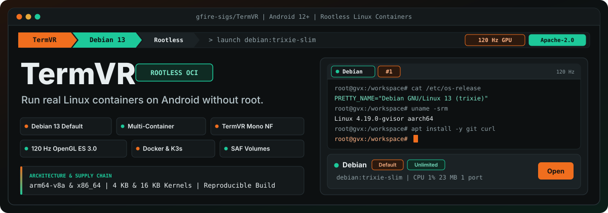
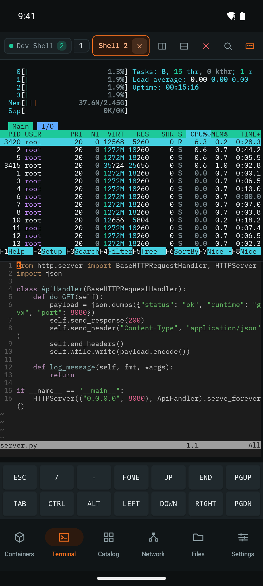
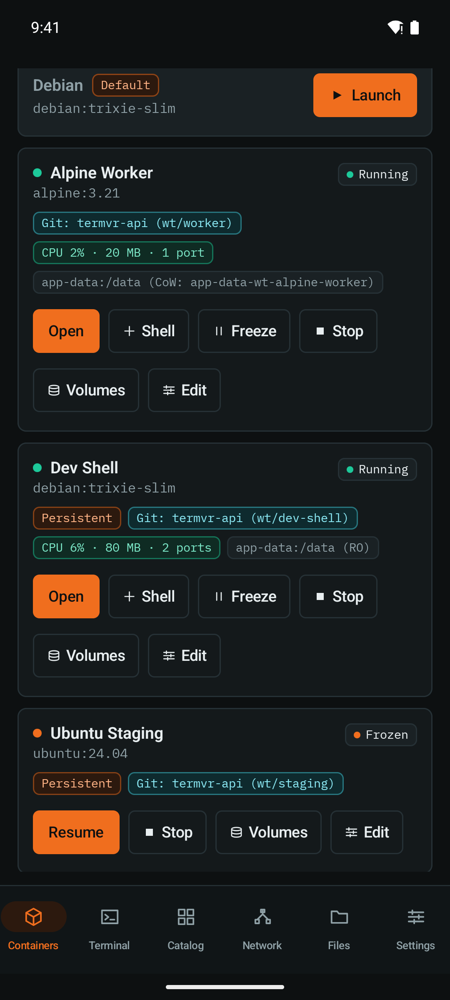
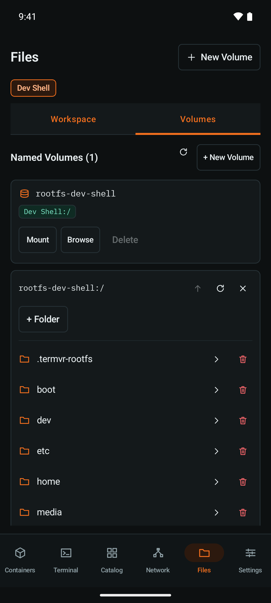
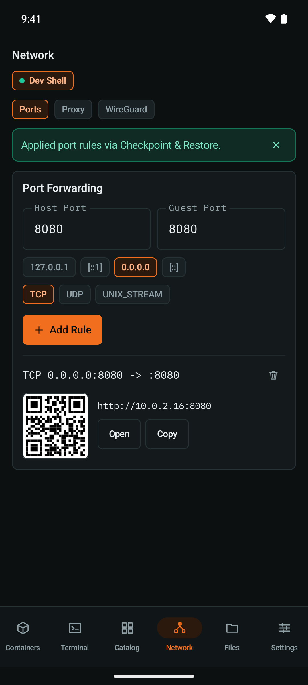
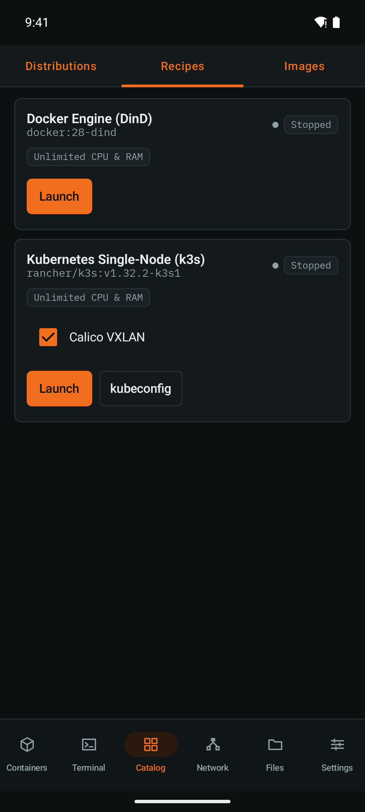

<p align="center">
  
</p>

<p align="center">
  <a href="https://github.com/gfire-sigs/TermVR/releases/latest">
    
  </a>
  <a href="https://github.com/gfire-sigs/TermVR/actions/workflows/ci.yml">
    
  </a>
  <a href="LICENSE">
    
  </a>
  
</p>

<p align="center">
  <a href="https://termvr.gfire.dev/">
    
  </a>
  <a href="https://apps.obtainium.imranr.dev/redirect?r=obtainium://add/https://github.com/gfire-sigs/TermVR">
    
  </a>
  <a href="https://github.com/gfire-sigs/TermVR/releases/latest">
    
  </a>
  <a href="https://github.com/gfire-sigs/TermVR/attestations">
    
  </a>
</p>

<p align="center">
  <strong><a href="docs/releases/v0.18.10022026111600.1.md">Release Notes</a></strong>
  &nbsp;&middot;&nbsp;
  <strong><a href="https://github.com/gfire-sigs/TermVR-Fonts">TermVR Mono NF</a></strong>
</p>

`TermVR` runs standard `arm64` and `x86_64` OCI Linux containers on unrooted Android 12+ devices. The runtime executes Linux system calls inside the `gvx` user-space kernel (`systrap`). Terminal views render through `libghostty-vt` over OpenGL ES 3.0 with the bundled `TermVR Mono NF` font.

## Screenshots

These screenshots run unmodified `arm64` Linux containers on an Android 16 16 KB kernel. Every terminal view renders through `libghostty-vt` over OpenGL ES 3.0.

<table>
  <tr>
    <td width="50%" align="center">
      
      <br>
      <sub>Split-pane Debian 13 shell showing <code>fastfetch</code>, Git history, Hangul output, and latched <code>CTRL</code>.</sub>
    </td>
    <td width="50%" align="center">
      
      <br>
      <sub>Concurrent <code>htop</code> process monitor and syntax-highlighted <code>vim</code> editor in one GPU surface.</sub>
    </td>
  </tr>
  <tr>
    <td width="50%" align="center">
      
      <br>
      <sub>Multi-container dashboard with live CPU and memory metrics, Git worktrees, CoW mounts, and frozen state.</sub>
    </td>
    <td width="50%" align="center">
      
      <br>
      <sub>Named <code>ext4lite</code> volumes with sparse disk metrics, shared read-only locks, and CoW branches.</sub>
    </td>
  </tr>
  <tr>
    <td width="50%" align="center">
      
      <br>
      <sub>Inbound <code>127.0.0.1</code> and confirmed <code>0.0.0.0</code> LAN port forwards with inline QR links.</sub>
    </td>
    <td width="50%" align="center">
      
      <br>
      <sub>Prebuilt <code>docker:28-dind</code> and single-node <code>k3s</code> recipes with Calico VXLAN and <code>kubeconfig</code> export.</sub>
    </td>
  </tr>
</table>

## How it works

`TermVR` pulls OCI images matching your device CPU and boots them inside `gvx`. Debian 13 (`debian:trixie-slim`) is the default quick-launch image, alongside Ubuntu, Fedora, Alpine, `docker:dind`, and single-node `k3s` in `Catalog`. Containers start with uncapped CPU and memory unless you enter explicit limits.

One static guest multiplexer (`termvr-agent`) shares a single sandbox across all open tabs and split panes. That multiplexer keeps host child processes to at most 4 per running container. The terminal host uses one `SurfaceView`, a two-row touch key bar, and a composition buffer for Hangul and CJK soft keyboards.

Inbound port rules bind `127.0.0.1` by default. Exposing a port on `0.0.0.0` requires confirmation and applies through checkpoint and restore. You can also route outbound container traffic directly or through `HTTP`, `HTTPS`, `SOCKS5`, `SOCKS4`, or an imported WireGuard tunnel.

## Storage and snapshots

By default, a container runs on an in-memory root over read-only image layers, similar to `docker run --rm`. Stopping an ephemeral container discards changes outside `/workspace` and mounted volumes.

Check **Persistent root (`ext4lite`)** when creating a container if you want `apt` packages and `/etc` files to survive full stops. `TermVR` then allocates a `rootfs-<id>.ext4` image for `/`, lists it under `Files > Volumes`, and deletes it if you remove the container.

- `/workspace` connects to Android's Storage Access Framework (`SAF`) so external Android editors can open and save project files.
- Named `ext4lite` volumes attach at custom mount paths for databases, Docker data, or `k3s` cluster state.
- `Freeze` checkpoints live processes to disk and exits the sandbox process, and `Resume` restores open shells and background jobs.

## Install

Install `TermVR` from [GitHub Releases](https://github.com/gfire-sigs/TermVR/releases/latest), [Obtainium](https://apps.obtainium.imranr.dev/redirect?r=obtainium://add/https://github.com/gfire-sigs/TermVR), or the [self-hosted F-Droid repository](https://termvr.gfire.dev/). Verify downloads against `SHA256SUMS` and [SLSA build attestations](https://github.com/gfire-sigs/TermVR/attestations). Each `arm64-v8a` APK works on both 4 KB and 16 KB page-size kernels on Android 12 and newer.

| Release file | Target devices | Notes |
| :--- | :--- | :--- |
| `TermVR-<tag>-arm64-v8a.apk` | 64-bit ARM phones, foldables, and tablets | Supports 4 KB and 16 KB Android kernels. |
| `TermVR-<tag>-x86_64.apk` | 64-bit x86 tablets, Chromebooks, and emulators | Matches `linux/amd64` container images. |
| `TermVR-<tag>.apks` | Accrescent and split-APK distribution | Developer-signed split APK set built with `bundletool`. |
| `TermVR-<tag>.aab` | Android App Bundle (`arm64-v8a` and `x86_64`) | Signed universal App Bundle archive. |
| `SHA256SUMS` | All downloads | Contains SHA-256 digests for all release artifacts. |

Add this URL in F-Droid, Droid-ify, or Neo Store to track signed `arm64-v8a` updates automatically:

```text
https://termvr.gfire.dev/fdroid/repo?fingerprint=74B6DE16E15A0FA8330D6013902E5F87348E69EA49E19FEF39FF7B52CD9120D3
```

Official app signing certificate SHA-256 fingerprint: `23FAEDB73343D4AE06DD849FCF803B39DA420A11B32AF8EF4EA1F63E1A5AC257`.

1. Install the APK matching your device architecture.
2. Open `TermVR` and tap `New Container`.
3. Enable **Persistent root (`ext4lite`)** if you want installed packages to survive container stops.
4. Tap `Create` and `Start` to pull the image and open a shell.
5. Tap `Freeze` on idle containers to save their state to disk.

> [!NOTE]
> Android kills background apps when system-wide child processes exceed 32. Enable `Disable child process restrictions` in Android Developer Options before running multiple containers at once.

## Build from source

`TermVR` builds from pinned upstream commits in [`scripts/source-lock.json`](scripts/source-lock.json) with zero proprietary SDKs or analytics libraries. Run these commands on Linux or macOS with JDK 17, Gradle `8.11.1`, and Android NDK `28.0.13004108` installed.

```bash
./scripts/provision-toolchains-and-vendor.sh
./scripts/build-native-deps.sh --abi arm64-v8a,x86_64
gradle :app:assembleRelease -PtermvrAbis=arm64-v8a,x86_64
```

Read [`CONTRIBUTING.md`](CONTRIBUTING.md) for offline F-Droid build rules and [`docs/designs/SITEMAP.md`](docs/designs/SITEMAP.md) for architecture documents.

## License and privacy

`TermVR` uses the [Apache License, Version 2.0](LICENSE). The bundled `TermVR Mono NF` font uses the SIL Open Font License 1.1 (`OFL-1.1`). Read [`PRIVACY.md`](PRIVACY.md) for the privacy policy, or open `Settings > Licenses` offline for full third-party notices.
