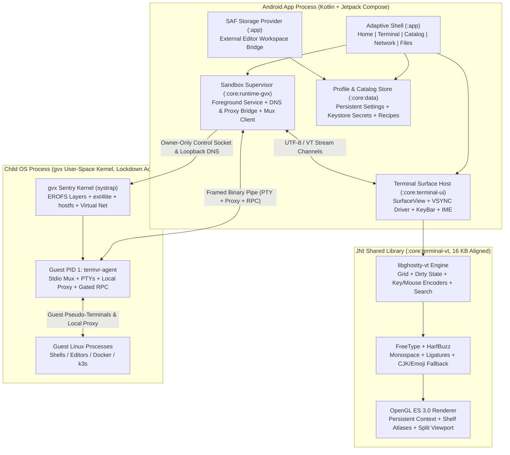
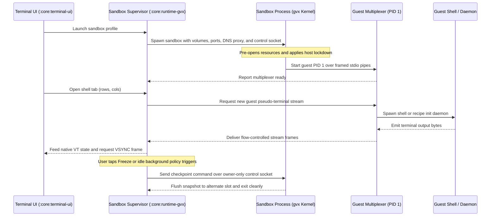
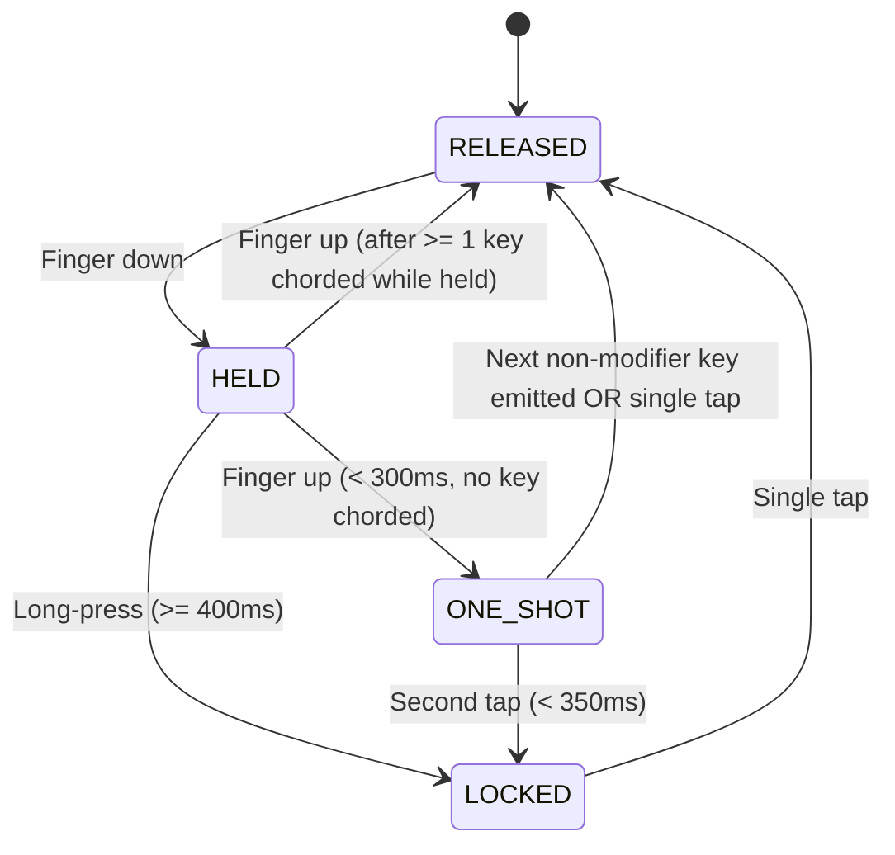

# Design 0001: TermVR Architecture and Product Specification

This specification defines the product architecture and implementation contracts for `TermVR` (`Terminal Virtual Runtime`, a mobile Linux container terminal). It follows the Elephant-Goldfish Model (`EGM`) and separates high-altitude architecture from low-level implementation contracts.

| Metadata | Value |
| :--- | :--- |
| **Document ID** | `0001` |
| **Status** | Approved Baseline (`Milestone 0`) |
| **Target Platforms** | Android 12+ (`API 31` to `API 36`), `arm64-v8a` (primary) and `x86_64` (emulator/desktop) |
| **Core Stack** | Kotlin, Jetpack Compose, Android NDK (JNI / OpenGL ES 3.0), `gvx`, `libghostty-vt` |
| **Distribution Targets** | F-Droid (`ReproducibleBuilds`) and GitHub Releases with Supply-chain Levels for Software Artifacts (`SLSA`) provenance |
| **EGM Boundaries** | `FeatureRange` (`Sections 1-9`) and `DetailedRange` (`Sections 10-18`) |

---

<!-- BEGIN FeatureRange -->

## 1. Overview and Heilmeier Catechism (Descriptive Module)

`TermVR` runs unmodified Linux container images on unrooted Android phones, foldables, and tablets. It combines a user-space Linux kernel sandbox with a GPU-rendered terminal viewport, touch modifier keys, prebuilt container recipes, and a reproducible source build pipeline.

### 1.1 Plain-Language Objectives

`TermVR` lets mobile users run standard Linux packages, container builds, and local Kubernetes clusters safely inside an ordinary Android application. Users select a standard Linux distribution, type commands with an on-screen modifier bar or physical keyboard, expose test ports, and freeze idle workspaces.

### 1.2 Current Practice and Operational Limits

Unrooted Android terminal applications rely on two legacy approaches. Both approaches break standard Linux container and developer workflows on modern Android releases.

- **Android-recompiled package prefixes**: Legacy apps recompile tools against Android's C library under a non-standard directory path. Standard Linux binaries, container images, and hard links fail, and Android 10+ write-xor-execute (`W^X`) policies block executing binaries from writable app folders.
- **Ptrace syscall translators**: User-space path translators intercept every system call via kernel debug stops, adding 2x to 5x overhead on file-heavy builds. They lack virtualized namespaces, control groups, and overlay mounts, so container engines and Kubernetes nodes cannot run.

Hardware virtual machines on Android require vendor hypervisor entitlements that retail phones disable for third-party applications.

### 1.3 New Approach and Technical Basis

`TermVR` executes unmodified host-architecture OCI images inside `gvx`, a user-space Linux kernel that intercepts system calls through shared-memory fast paths (`systrap`). `gvx` implements user-space namespaces, control groups, overlay mounts, and packet filtering, allowing nested Docker and Kubernetes daemons to run without root access.

Android forbids executing files stored in writable app directories. `TermVR` packages the sandbox runtime inside Android's read-only native library directory so the OS permits spawning it as a child process. Container layers compile into Enhanced Read-Only File System (`EROFS`) files. Writable Linux volumes use sparse `ext4lite` images with online hole punching and copy-on-write overlays. Shared folders and bare Git project hubs use synchronized `hostfs` mounts across concurrent sandboxes.

For interactive display, `TermVR` embeds `libghostty-vt` and renders glyph atlases via OpenGL ES 3.0 at display refresh rates (`60 Hz` to `120 Hz`). A tiny static guest multiplexer shares one sandbox across all open terminal tabs, capping host child processes at 4 per sandbox.

### 1.4 Beneficiaries and Operational Impact

Developers, site reliability engineers, security auditors, and students gain a standard Linux environment on existing Android devices without unlocking bootloaders. Users run unmodified Linux `arm64` packages, test container builds offline, validate Kubernetes manifests, and edit project files from external Android editors.

### 1.5 Risks, Costs, and Mitigations

Delivering a user-space Linux kernel and GPU terminal on Android carries explicit resource costs and four platform risks.

- **Runtime and engineering costs**: Each idle sandbox consumes 35 MiB to 55 MiB of host RAM. Base distribution images occupy 15 MiB to 90 MiB on disk, while Docker and Kubernetes volumes allocate 800 MiB to 2.5 GiB. The release APK budget is 45 MiB across 13 engineering weeks (`M1` through `M5`).

| Risk Area | Failure Mechanism | Architectural Mitigation |
| :--- | :--- | :--- |
| **Android 32-process cap** | Android terminates child processes when system-wide app subprocesses exceed 32. | Multiplex all tabs of a sandbox through one guest agent (`<= 4` host processes per sandbox) and guide Android 14+ developer toggle setup. |
| **Post-boot host lockdown** | The sandbox seals new host port binds and host file opens before guest code starts. | Pre-bind configured port pools and checkpoint sockets before boot, and apply live port edits through automated checkpoint-and-restore cycles. |
| **16 KB kernel page size** | Android 15+ `arm64` kernels reject native binaries linked with 4 KB ELF segment alignment. | Link every native library with 16 KB segment alignment and use `gvx` sub-block page mapping on 16 KB hosts. |
| **F-Droid multi-toolchain build** | F-Droid build servers reject proprietary plugins, mid-build network access, and non-deterministic binary outputs. | Pin Go, Zig, NDK, and font commits in a lockfile, prefetch verified caches before build isolation, and strip build IDs. |

### 1.6 Milestone Schedule

Implementation proceeds across five sequential milestones following this `Milestone 0` structural baseline. Each milestone ships a self-contained vertical slice verified in continuous integration.

| Milestone | Scope Summary | Target Duration |
| :--- | :--- | :--- |
| **`M0` (Current)** | Multi-module Gradle and Go directory skeleton, F-Droid metadata, source lockfile, and system design specification. | Completed |
| **`M1`: Core VT & GPU Surface** | Native `libghostty-vt` bridge, FreeType/HarfBuzz glyph shaping, OpenGL ES 3.0 renderer, auxiliary key bar, and Hangul/CJK input. | 3 weeks |
| **`M2`: Sandbox Supervisor & Mux** | Foreground sandbox service, guest stdio session multiplexer, wake lock, live telemetry notification, and checkpoint/restore. | 3 weeks |
| **`M3`: Catalog, Recipes & Network** | Distribution gallery, Docker and Kubernetes recipes, loopback/LAN port forwards, `HTTP`/`HTTPS`/`SOCKS5`/`SOCKS4` proxy bridge, and WireGuard networking. | 3 weeks |
| **`M4`: Storage Bridge & Polish** | Integrated workspace and `ext4lite` volume browser, Storage Access Framework (`SAF`) editor provider, and tablet/foldable layouts. | 2 weeks |
| **`M5`: Reproducible Release & F-Droid** | Clean-room APK reproducibility verification, `SLSA` provenance workflow, accessibility pass, and F-Droid recipe submission. | 2 weeks |

### 1.7 Midterm and Final Verification Exams

`Midterm Exam` (`end of M2`) and `Final Exam` (`end of M5`) enforce pass/fail thresholds. Latency and GPU gates target a mid-tier physical `arm64` phone (`8-core Cortex-A78 class, UFS 3.1, 120 Hz`), while the Android 16 16 KB emulator verifies page-size alignment and functional parity.

| Exam Gate | Verification Metric | Pass Threshold |
| :--- | :--- | :--- |
| **Cached Shell Cold Start (`Midterm`)** | Time from tapping `Launch` on a cached Debian 13 (`debian:trixie-slim`) profile to an interactive shell prompt. | `<= 600 ms` P95 on reference device |
| **High-Refresh Rendering (`Midterm`)** | Render-thread frame time on dirty frames at `120 Hz` during full-screen editor scrolling. | `<= 4.0 ms` P95; `0` render wakeups when idle |
| **Subprocess Budget (`Midterm`)** | Total host OS child processes spawned for one sandbox running 8 concurrent shell tabs. | `<= 4` host child processes |
| **CJK & Modifier Input (`Midterm`)** | Korean Hangul syllable composition and latched `CTRL` chords on Gboard and Samsung Keyboard. | `100%` exact byte output; zero dropped jamo |
| **Checkpoint & Restore (`Final`)** | Freeze and resume round-trip for an active `256 MiB` workspace with open editor buffers. | `<= 5.0 s` round-trip; open shells preserved |
| **Port, Proxy & LAN Gate (`Final`)** | Loopback default, LAN `0.0.0.0` gate, and live `HTTP`/`HTTPS`/`SOCKS5`/`SOCKS4` proxy switching without DNS leaks. | `100%` enforcement across Wi-Fi changes |
| **External Editor Bridge (`Final`)** | Edit and save a sandbox `/workspace` file from an external Android editor without partial reads. | Atomic file update visible inside guest |
| **Docker & K3s Recipes (`Final`)** | Unmodified `docker:dind` container launch and `rancher/k3s` node readiness on `ext4lite` volumes. | Both pass end-to-end on physical `arm64` |
| **Reproducible APK (`Final`)** | Clean-room rebuild compared against published release APK after copying the signing block. | `0` byte differences (`SHA-256` match) |

---

## 2. The Problem (Descriptive Module)

Modern Android devices offer desktop-class `arm64` CPUs, 8 GiB to 16 GiB of RAM, and high-refresh displays. Four platform barriers still block standard Linux development on unrooted devices:

- **Filesystem and binary restrictions**: Android app directories forbid hard links under SELinux and block executing downloaded binaries (`W^X`). Standard OCI images expect POSIX permissions, hard links, overlay filesystems, and standard root paths.
- **Aggressive background process management**: Android caps system-wide app child processes at 32, throttles background CPU execution when the screen turns off, and reclaims memory without preserving terminal state.
- **Touch and CJK input mismatches**: Terminal emulators assume physical keyboards with `ESC`, `CTRL`, and `ALT`, and corrupt Korean, Japanese, and Chinese soft-keyboard syllable composition.
- **Opaque binary supply chains**: Mobile developer apps often embed unpinned native binaries or proprietary telemetry libraries, failing F-Droid reproducible build audits.

---

## 3. Goals and Non-Goals (Descriptive Module)

This section defines the product goals and explicit boundaries for `TermVR` `v1.0`. Every feature decision maps to these bounds.

### 3.1 Goals

Six measurable engineering goals govern `TermVR` `v1.0`.

- **G1 (Host-Architecture OCI Execution)**: Run unmodified OCI images matching the host CPU (`linux/arm64` on `arm64-v8a`; `linux/amd64` on `x86_64`), including Docker and Kubernetes recipes.
- **G2 (GPU-Accelerated VT Emulation)**: Render terminal grids, ligatures, Nerd Font symbols, CJK fallback fonts, and Kitty inline graphics at up to `120 Hz`.
- **G3 (Mobile-First Input Ergonomics)**: Provide a configurable two-row auxiliary key bar, three-state modifier latches, touch gestures, hardware keyboard parity, and composition-safe CJK IME input.
- **G4 (Explicit Network, Proxy & Storage Control)**: Support loopback/LAN port forwards, `HTTP`/`HTTPS`/`SOCKS5`/`SOCKS4` and system proxies, dynamic DNS, WireGuard, copy-on-write volume branching, volume compaction, shared Git worktrees, and `SAF` access.
- **G5 (Resilient Mobile Lifecycle)**: Maintain background execution through a foreground notification with live CPU and Proportional Set Size (`PSS`) memory metrics, timed wake locks, and checkpoint/restore.
- **G6 (Trusted Reproducible Build)**: Compile all Kotlin, Go, Zig, and C/C++ sources deterministically from pinned commits for F-Droid `ReproducibleBuilds` and `SLSA` v1.0 Build Level 2 provenance.

### 3.2 Non-Goals

Six items remain outside `TermVR` `v1.0` scope so core terminal and sandbox reliability stays bounded.

- **NG1 (No Root Mode)**: `TermVR` never requires root access, bootloader unlocking, or host kernel modifications.
- **NG2 (No Graphical Desktop Server in v1.0)**: `TermVR` renders terminal grids and inline Kitty graphics rather than a full Wayland or X11 window compositor.
- **NG3 (No Custom Package Distribution)**: `TermVR` uses upstream Linux distribution package managers inside OCI images rather than maintaining Android-patched packages.
- **NG4 (No Upstream Engine Forks)**: `TermVR` builds unmodified upstream commits of `gvx` and `ghostty` without maintaining divergent fork branches.
- **NG5 (No Cloud Accounts or Telemetry)**: `TermVR` collects zero analytics or crash telemetry and opens network connections only for user-initiated registry pulls or guest traffic.
- **NG6 (No Cross-ISA CPU Emulation in v1.0)**: `arm64-v8a` devices execute `linux/arm64` images natively without emulating `amd64` instructions.

---

## 4. Resolved Architectural Decisions (Descriptive Module)

Seven architectural decisions eliminate design ambiguity across process supervision, networking, proxying, rendering, and typography.

| ID | Question | Binding Decision | Rationale |
| :--- | :--- | :--- | :--- |
| **D1** | How do multiple tabs share one sandbox when `gvx` runs a single foreground command without a daemon? | Mount a static guest PID 1 multiplexer read-only into the sandbox to allocate guest pseudo-terminals over framed `stdin`/`stdout` pipes, with a single-PTY fallback mode. | Works across NAT, WireGuard, and offline modes, consumes zero network ports, caps host child processes at 4 per sandbox, and survives checkpoint/restore. |
| **D2** | How do users edit port forwards when the sandbox seals host socket binds before guest startup? | Stage port changes in the UI and offer one-tap `Checkpoint & Restore` (keeping open shells in memory) or `Cold Restart` (preserving persistent volumes). | Respects host lockdown invariants while letting users expose newly started guest servers without losing workspace state. |
| **D3** | How does `TermVR` freeze idle background sandboxes without failing to spawn helper processes under memory pressure? | Send checkpoint commands directly from the Android service over a pre-opened owner-only Unix control socket using rotating snapshot slots. | Avoids spawning a new OS process during memory pressure and preserves the prior snapshot if storage fills mid-save. |
| **D4** | How does `TermVR` render split panes without exhausting Android display overlays or flashing black on tab switches? | Draw all split panes of the terminal screen inside one shared OpenGL ES 3.0 surface backed by a persistent surfaceless GL context. | Stays within Android's hardware overlay budget, shares one glyph atlas across panes, and redraws triple buffers cleanly on surface recreation. |
| **D5** | How does guest DNS keep working when the phone roams between Wi-Fi, 5G cellular, VPNs, and Private DNS? | Run an app-local loopback DNS forwarder routed through Android's active network resolver instead of passing static boot-time DNS server IPs. | Survives airplane-to-Wi-Fi transitions, cellular handoffs, host VPNs, and DNS-over-TLS policies without restarting the sandbox. |
| **D6** | How does text shaping remain identical across vendor Android ROMs? | Bundle FreeType and HarfBuzz statically inside the JNI library with `TermVR Mono NF` (`v1.1.0` Regular subset), querying system fonts only for extra CJK or emoji fallback. | Guarantees uniform cell dimensions, box drawing, and cursor-aware ligatures across all Android OEMs. |
| **D7** | How do host image pulls and guest tools use `HTTP`, `HTTPS`, `SOCKS5`, and `SOCKS4` proxies across single-VPN limits and Wi-Fi switches? | Run a host `LoopbackProxyBridge` paired with a guest `127.0.0.1:1080` listener (and optional `SO_ORIGINAL_DST` redirect) over `stdio` mux streams. | Translates `SOCKS4/4a` and authenticated proxies for all tools, keeps credentials out of guest `env`, works under `-isolate-lan`, and hot-swaps upstream proxies live. |

---

## 5. Critical User Journeys (Descriptive Module)

Six end-to-end journeys define observable behavior across UI screens and runtime boundaries.

### 5.1 CUJ 1: First-Run Diagnostics and Quick Shell Launch

- **Given** a fresh installation of `TermVR` on an unrooted Android 14+ `arm64` phone on Wi-Fi.
- **When** the user inspects the host readiness card on `Home` and taps `Quick Shell (Debian 13)`.
- **Then** `TermVR` pulls and compiles the `debian:trixie-slim` (`linux/arm64`) image into persistent storage and starts the foreground sandbox service. Cached launches open an interactive shell prompt within `600 ms`.

### 5.2 CUJ 2: Multi-Tab Editing with Auxiliary Modifiers and Hangul/CJK Input

- **Given** a running Ubuntu sandbox with `nvim` open in Tab 1.
- **When** the user opens Tab 2 and types Korean text with a Hangul soft keyboard. Next, the user taps `ESC`, latches `CTRL` to split panes, and pinches to zoom.
- **Then** Tab 2 opens inside the same sandbox without extra host processes, and Hangul syllables compose without dropped jamo. `CTRL` resets after one chord, and split panes resize inside one GPU surface.

### 5.3 CUJ 3: Prebuilt Docker Engine and Kubernetes (`k3s`) Recipes

- **Given** an Android device with at least `6 GiB` physical RAM.
- **When** the user opens `Catalog`, launches the `Kubernetes Single-Node (k3s)` recipe, and confirms volume creation and loopback port rules.
- **Then** `TermVR` boots `k3s` on a dedicated `ext4lite` volume and streams daemon logs in Stream 0. A ready shell tab opens with `kubectl` configured and one-tap `kubeconfig` export.

### 5.4 CUJ 4: LAN Port Exposure (`0.0.0.0`) and Live Outbound Proxy Switching

- **Given** a web server on port `8000` inside a running sandbox and a local `SOCKS5` tunnel on `127.0.0.1:9050`.
- **When** the user enables the `SOCKS5` outbound proxy and switches port `8000` to `0.0.0.0` via `Checkpoint & Restore`.
- **Then** outbound guest traffic routes through `SOCKS5` immediately without exposing credentials, and `Network` displays a LAN QR code plus `[LAN 0.0.0.0]` and `[Proxy]` badges.

### 5.5 CUJ 5: Directory Browser and External Android Editor Bridge

- **Given** project files inside a profile's `/workspace` or shared Git worktree and container data inside a mounted `ext4lite` volume.
- **When** the user browses storage roots, compacts or branches a volume in `Files`, or opens workspaces and Git worktrees from an external Android editor.
- **Then** external editor saves update host files atomically, compacted volumes reclaim sparse disk blocks, and `Files` transfers files into mounted `ext4lite` volumes.

### 5.6 CUJ 6: Background Compilation, Wake Lock, and Idle Background Freeze

- **Given** a long-running build inside `TermVR` while the user turns off the display or switches apps.
- **When** the user enables a 30-minute wake lock from the status notification during compilation. Later, an idle shell sandbox remains in the background after the wake lock expires.
- **Then** the notification reports live CPU and `PSS` memory while the screen is on and holds the CPU wake lock. Idle non-daemon sandboxes checkpoint safely in the background.

---

## 6. Technical Plan: System Architecture (Descriptive Module)

`TermVR` isolates execution across three runtime domains. These domains are the **Android UI & Supervisor Process**, the **Native VT & OpenGL Engine**, and the **Locked-Down Sandbox Process** (`gvx` plus guest workloads).



### 6.1 Information Architecture and Adaptive Screen Layout

`TermVR` presents five primary navigation destinations (`Home`, `Terminal`, `Catalog`, `Network`, `Files`) plus `Settings`. Phones show a bottom bar that hides when the soft keyboard opens on `Terminal`. Foldables, tablets, and desktop windows use a left navigation rail.

| Destination | Primary User Task | Key Sub-Views and Controls |
| :--- | :--- | :--- |
| **`Home`** | Launch profiles, inspect host readiness, and control live sandboxes. | Quick-launch tiles; active and frozen sandbox cards; volume mode and shared Git worktree configuration; host health banner. |
| **`Terminal`** | Interact with multi-tab shells, split panes, and daemon logs. | Top tab strip with sandbox indicator; single-surface split-pane viewport; session drawer; scrollback search bar; collapsible two-row auxiliary key bar. |
| **`Catalog`** | Pull host-ISA distributions, launch Docker/Kubernetes recipes, or import archives. | `Distributions` tab (`Alpine`, `Debian`, `Ubuntu`, `Fedora`); `Recipes` tab (`Docker`, `Kubernetes`); `Local Images` tab (pull, tar load/export, prune, registry auth). |
| **`Network`** | Configure port forwards, outbound `HTTP`/`HTTPS`/`SOCKS5`/`SOCKS4` proxies, and WireGuard. | Inbound port rules plus `0.0.0.0` gate and QR modal; outbound proxy (`Direct`, `System`, `HTTP`, `HTTPS`, `SOCKS5`, `SOCKS4`, transparent TCP, remote DNS); WireGuard importer. |
| **`Files`** | Browse workspaces, `ext4lite` volumes, and shared Git projects. | Workspace, volume, and Git project manager; physical disk metrics, offline compaction, and copy-on-write branching; `SAF` archive transfers and external editor launch. |

### 6.2 Terminal Emulation and Single-Surface OpenGL ES 3.0 Pipeline

`:core:terminal-vt` owns `libghostty-vt` state, HarfBuzz/FreeType text shaping, and OpenGL ES 3.0 atlas rendering in one JNI library. `:core:terminal-ui` hosts the Android display surface and display-sync frame callback. All visible split panes render inside one hardware surface partitioned by scissor viewports. A persistent OpenGL context survives tab switches without losing glyph or Kitty image textures.

The render loop wakes strictly on dirty state. Output bytes update native terminal cells and arm a single display-sync frame callback; clean frames unregister the callback so idle terminals trigger zero render-thread wakeups.

### 6.3 Touch Modifiers, Gestures, Hardware Keyboards, and CJK IME Pipeline

`TermVR` unifies touch modifiers, soft-keyboard composition, and physical keyboards through `libghostty-vt`'s terminal-mode-aware key encoder:

- **Auxiliary Key Bar and Hardware Keys**: A dockable two-row bar provides `ESC`, `TAB`, `CTRL`, `ALT`, arrows, navigation keys, and customizable symbol slots. `CTRL` and `ALT` follow a three-state latch (`released`, `one-shot`, `locked`, plus multi-touch `held`). Physical keyboards merge hardware and soft-bar modifiers directly.
- **Hangul/CJK-Safe Soft Keyboard Bridge**: An editable virtual sentinel buffer supports Hangul jamo assembly, Japanese conversion, Gboard spacebar cursor scrubbing, and predictive replacement without sending incomplete syllables to the shell. Active composition renders in an inline cursor overlay and flushes automatically before any control key or `ESC` tap.

### 6.4 Sandbox Lifecycle, Session Multiplexing, Gated Host Helpers, and Notification

Each running sandbox executes inside one supervised `gvx` child process stored on non-evictable app storage so Android cache cleanup never deletes user volumes. Loopback DNS and proxy bridges route traffic dynamically across Wi-Fi, cellular, host VPN, and Private DNS. They also switch upstream `HTTP`, `HTTPS`, `SOCKS5`, and `SOCKS4` proxies without restarting the sandbox.



The guest multiplexer exposes five gated Guest-to-Host calls over stream 0. Guests can open `http`/`https` URLs in Custom Tabs, write clipboard text, or share a guest file. Clipboard reads require explicit opt-in, and `Files` streams reads and writes for mounted `ext4lite` volumes.

While sandboxes run, an ongoing notification shows active count, CPU %, `PSS` memory, and `[LAN 0.0.0.0]`, `[Proxy]`, or `[Wake Lock]` badges with `Wake Lock`, `Freeze`, and `Stop All` actions. If Android notification permission is denied, an in-app status banner mirrors these controls and caps wake locks at 30 minutes. When all sandboxes are frozen, the foreground service stops and posts a passive `"Frozen Sandboxes"` notification with one-tap `Resume`.

### 6.5 Trusted Build Infrastructure and F-Droid Distribution

`TermVR` builds deterministically from source with zero proprietary libraries:

- **Open-source dependency scoping**: Gradle resolves libraries exclusively from Maven Central and open-source AndroidX repositories, omitting encrypted Play dependency metadata blocks.
- **Pinned source lockfile**: Every native input (`gvx`, `ghostty`, `FreeType`, `HarfBuzz`, and bundled fonts) builds from an exact Git commit SHA verified before offline compilation.
- **Reproducible release pipeline**: Deterministic compiler, archive, and R8 flags produce identical unsigned APK payloads across F-Droid builders and GitHub Actions (`SLSA` v1.0 Level 2).

---

## 7. Alternatives Considered (Descriptive Module)

Six alternative designs were evaluated against mobile latency, Android sandbox rules, and F-Droid build policies.

| Option Evaluated | Pros | Cons | Reason for Rejection |
| :--- | :--- | :--- | :--- |
| **1. Flutter UI + Platform Views** | Shared UI framework if targeting desktop or iOS later. | Adds ~10 MiB engine overhead, extra surface composition lag, CJK IME quirks, and complex Dart bootstrap rules on F-Droid. | Native Kotlin, Jetpack Compose, and JNI integrate directly with Android services, IMEs, `SAF`, and `SurfaceView`. |
| **2. Android Bionic Custom Package Prefix** | Direct host execution without user-space syscall interception. | Breaks standard `/bin`/`/usr` paths, glibc binaries, `dockerd`, `k3s`, and hard links; blocked by Android `W^X` storage rules. | `gvx` runs unmodified Linux distributions and nested container stacks without maintaining thousands of patched packages. |
| **3. One Sandbox Process per Terminal Tab** | Avoids bind-mounting a guest multiplexer binary. | Spawns up to 4 host processes per tab, hitting Android's 32-process killer at 8 tabs and isolating `/tmp` between tabs. | Multiplexing over `stdin`/`stdout` keeps all tabs of a sandbox inside `<= 4` host processes with shared kernel state. |
| **4. Android `Canvas` Text Rendering** | Pure Kotlin view code without custom OpenGL shaders. | High CPU cost during fast scrolling; vendor font fallback breaks uniform cell widths; no instanced Kitty image composition. | OpenGL ES 3.0 instanced rendering with bundled FreeType/HarfBuzz delivers sub-4 ms dirty frames and uniform metrics. |
| **5. Vulkan-Only Terminal Renderer** | Lower driver overhead on modern flagship GPUs. | Higher swapchain boilerplate and driver quirks on older Android 12 SoCs and CI emulator images for a 2D quad workload. | OpenGL ES 3.0 is universally supported on Android 12+ hardware with manifest feature enforcement; Vulkan remains an optional future backend. |
| **6. Prebuilt Native Binaries in Git/Maven** | Faster local builds for UI-only changes. | Disqualifies the app from F-Droid source-built inclusion and obscures native binary provenance. | Source-locked builds with CI artifact caching satisfy both F-Droid policy and cryptographic auditability. |

---

## 8. Non-Functional Requirements (Descriptive Module)

This section specifies mandatory security, performance, accessibility, and upgrade invariants across all modules. Every pull request verifies compliance against these bounds.

### 8.1 Security and Isolation

Five isolation boundaries protect the Android host, proxy credentials, and local network from untrusted guest workloads.

- **Mandatory host lockdown**: Production builds always enable `gvx` host lockdown (`seccomp` filters and pinned directory descriptors) before guest execution begins.
- **Session-scoped LAN exposure**: Port forwards default to `127.0.0.1`. Binding `0.0.0.0` or `[::]` requires user confirmation, downgrades or re-prompts when Wi-Fi networks change, forbids unauthenticated Docker TCP port `2375`, and displays `[LAN 0.0.0.0]`.
- **Owner-only sockets and CA isolation**: Control and Unix forward sockets reside in app-private storage accessible only to `TermVR`'s Android UID, and host CA certificate injection remains opt-in per profile.
- **Credential-isolated proxy bridge**: Upstream proxy passwords stay encrypted in Android Keystore and never enter guest `env` variables. Host loopback proxy ports require a random 128-bit per-command token.
- **Gated guest helper RPCs**: Guest clipboard reads default to `Disabled`. URL opens require `http`/`https` schemes in Custom Tabs, and file shares open Android's system share sheet.

### 8.2 Performance, Process, and Battery Budgets

Five quantitative resource budgets govern rendering latency, background battery use, and package size.

| Dimension | Budget / Invariant | Enforcement Mechanism |
| :--- | :--- | :--- |
| **Dirty Frame Latency (`120 Hz`)** | `<= 4.0 ms` P95 GL render time on reference `arm64` hardware | Dirty-row partial vertex uploads plus two-pass instanced OpenGL ES 3.0 drawing. |
| **Idle Render & Screen-Off Power** | `0` render-thread wakeups when terminal output and cursor blink are idle; `0` telemetry polls when screen is off | Unregister display-sync callback when clean; pause telemetry sampler while display is non-interactive. |
| **Host Subprocess Cap** | Default warning above `3` concurrent running sandboxes (`<= 12` `TermVR` child processes) | Track live `TermVR` child processes and inspect Android historical exit reasons for phantom-killer diagnostics. |
| **Wake Lock Safety** | Indefinite (`Until Stopped`) default when notifications are permitted (`30 min` cap if denied) | Auto-release wake lock on timer expiry or when all sandboxes freeze or stop. |
| **APK Size (`arm64-v8a`)** | `<= 45 MiB` compressed release APK | Enable R8 code/resource shrinking and symbol-stripped native binaries compressed for install-time extraction. |

### 8.3 Accessibility and Device Adaptability

Three adaptability rules keep `TermVR` usable across screen readers, visual impairments, and large-screen postures.

- **Screen reader and independent zoom**: Compose UI obeys system font scaling, while the terminal viewport exposes a virtual accessibility tree for TalkBack and independent `8 sp` to `32 sp` pinch-to-zoom.
- **Accessible color palettes**: Built-in themes include WCAG AAA high-contrast dark/light and deuteranopia-safe 16/256/TrueColor palettes.
- **Foldable and desktop continuity**: Posture folds, split-screen resizing, and external DeX displays resize the single GL surface smoothly without restarting sandboxes.

### 8.4 Rollout and Rollback Strategy

Explicit schema versions protect user profiles and persistent volumes across application and engine upgrades.

- **Versioned persistence and wire framing**: Profile storage, multiplexer handshakes, and checkpoint manifests validate explicit version numbers before execution.
- **Safe checkpoint fallback on upgrade**: When an updated `gvx` engine rejects an older checkpoint, `TermVR` marks that snapshot superseded and offers a clean cold boot. All `ext4lite` volumes and `/workspace` files remain intact.
- **Upstream runtime version alignment**: Application release versions track the pinned `gvx` release tag with an optional app revision suffix and a monotonic Android version code.

---

## 9. Additional Resources and Future Improvements (Reference Module)

This section links authoritative upstream specifications and records post-`v1.0` roadmap candidates. None of the roadmap items below alter `v1.0` module boundaries.

### 9.1 Upstream References

Four upstream specifications define the external contracts consumed by `TermVR`.

- `gvx` User-Space Kernel and CLI Reference: `https://github.com/gfire-sigs/gvx` (`v0.18.10022026111600`)
- `Ghostty` and `libghostty-vt` C API: `https://github.com/ghostty-org/ghostty` (`vt-1.0.1`)
- Elephant-Goldfish Design Model (`EGM`): `https://github.com/google/elephant-goldfish-model`
- F-Droid Reproducible Builds Guide: `https://f-droid.org/docs/Reproducible_Builds/`

### 9.2 Post-v1.0 Future Improvements

Four additive capabilities are deferred until after the `v1.0` F-Droid release.

- **Android Virtualization Framework (`AVF`) Backend**: Support optional hardware-virtualized execution on Android 16+ devices that grant unprivileged `AVF` access.
- **Optional Vulkan Renderer**: Add a Vulkan backend alongside OpenGL ES 3.0 behind the native renderer abstraction.
- **Integrated SSH / Mosh Profiles**: Reuse the terminal surface, key bar, and IME bridge for remote SSH sessions.
- **Wayland Single-App Surface Forwarding**: Preview graphical Linux developer tools inside a tab without bundling a full desktop environment.

<!-- END FeatureRange -->

---

<!-- BEGIN DetailedRange -->

## 10. Repository Layout and File Inventory (Reference Module)

This section maps every committed `Milestone 0` (`M0`) skeleton file and every planned `M1` through `M5` implementation file. No source files outside this inventory may introduce cross-module dependencies without updating this specification.

### 10.1 Committed Milestone 0 Skeleton Inventory

The table below lists all structural, build, metadata, and governance files committed in `M0`. Zero runtime implementation code exists in `M0`.

| Path | Module / Domain | Purpose in `M0` Baseline |
| :--- | :--- | :--- |
| `settings.gradle.kts` | Root Gradle | Declares 6 modules and restricts Maven repositories to Maven Central plus `com.android.*`/`androidx.*`. |
| `build.gradle.kts` | Root Gradle | Pins root plugin aliases and enforces deterministic archive timestamps and entry ordering. |
| `gradle.properties` | Root Gradle | Configures JVM heap, non-transitive R classes, configuration cache, and K2 compiler flags. |
| `gradle/libs.versions.toml` | Root Gradle | Pins AGP `8.9.1`, Kotlin `2.1.20`, Compose BOM `2025.03.00`, NDK `28.0.13004108`, `gvx`, `ghostty`, Zig, and Go. |
| `gradle/wrapper/gradle-wrapper.properties` | Root Gradle | Pins Gradle `8.11.1` distribution URL for reproducible local and CI builds. |
| `app/build.gradle.kts` | `:app` | Configures application ID `dev.gfire.termvr`, `-PtermvrAbis`, `includeInApk = false`, `useLegacyPackaging = true`, and R8. |
| `app/proguard-rules.pro` | `:app` | Preserves kotlinx-serialization descriptors and JNI entrypoints under release R8 shrinking. |
| `app/src/main/AndroidManifest.xml` | `:app` | Declares OpenGL ES 3.0 requirement, `extractNativeLibs="true"`, foreground service permissions, and `SAF` provider slot. |
| `core/model/build.gradle.kts` | `:core:model` | Pure Kotlin JVM module with `kotlinx-serialization-json` and JUnit 5 test runner. |
| `core/data/build.gradle.kts` | `:core:data` | Android library module for DataStore persistence and bundled recipe definitions. |
| `core/data/src/main/AndroidManifest.xml` | `:core:data` | Minimal manifest for the `:core:data` Android library namespace. |
| `core/terminal-vt/build.gradle.kts` | `:core:terminal-vt` | JNI library module configuring CMake `3.22.1`, NDK `r28`, `-PtermvrAbis`, and `ANDROID_SUPPORT_FLEXIBLE_PAGE_SIZES=ON`. |
| `core/terminal-vt/consumer-rules.pro` | `:core:terminal-vt` | Consumer keep rules protecting `@Keep` JNI callback methods in downstream R8 builds. |
| `core/terminal-vt/src/main/AndroidManifest.xml` | `:core:terminal-vt` | Minimal manifest for the `:core:terminal-vt` JNI library namespace. |
| `core/terminal-vt/src/main/cpp/CMakeLists.txt` | `:core:terminal-vt` | Enforces `-Wl,-z,max-page-size=16384` and `-Wl,--build-id=none` on `libtermvr_vt.so`. |
| `core/terminal-ui/build.gradle.kts` | `:core:terminal-ui` | Compose and OpenGL ES 3.0 viewport module depending on `:core:model` and `:core:terminal-vt`. |
| `core/terminal-ui/src/main/AndroidManifest.xml` | `:core:terminal-ui` | Minimal manifest for the `:core:terminal-ui` Android library namespace. |
| `core/runtime-gvx/build.gradle.kts` | `:core:runtime-gvx` | Sandbox supervisor, DNS proxy, multiplexer client, and foreground service module. |
| `core/runtime-gvx/src/main/AndroidManifest.xml` | `:core:runtime-gvx` | Minimal manifest for the `:core:runtime-gvx` supervisor namespace. |
| `guest/termvr-agent/go.mod` | `guest/termvr-agent` | Standalone zero-dependency Go `1.27.4` module (`dev.gfire.termvr/guest/termvr-agent`). |
| `scripts/source-lock.json` | Build & Provenance | Exact commit SHAs and SPDX licenses for `gvx`, `ghostty`, `freetype`, `harfbuzz`, and bundled fonts. |
| `fdroid/dev.gfire.termvr.yml` | F-Droid Metadata | Source-built F-Droid recipe with `prebuild:` external toolchain prefetch, `build:` offline native compilation, and `arm64-v8a` ABI. |
| `fastlane/metadata/android/en-US/*.txt` | Store Metadata | F-Droid title, 80-character summary, and plain-text long description. |
| `AGENTS.md`, `CONTRIBUTING.md`, `CHANGELOG.md`, `README.md` | Governance | Agent rules, contributor workflow, release log, and repository overview. |
| `docs/designs/SITEMAP.md`, `docs/designs/0001-termvr-system-design.md` | Design Docs | `EGM` design index and this master architecture and implementation specification. |

### 10.2 Planned Milestone 1 to Milestone 5 Implementation Targets

The table below maps every planned production file across `M1` through `M5`, marking whether each target creates a new file or modifies an `M0` file.

| Milestone | Action | Target Path | Owning Module | Responsibility |
| :--- | :--- | :--- | :--- | :--- |
| **`M1`** | `Create` | `core/model/src/main/kotlin/dev/gfire/termvr/core/model/TerminalModels.kt` | `:core:model` | `KeyBarConfig`, `ModifierLatchState`, `FontConfig`, and `ColorPalette` schemas. |
| **`M1`** | `Modify` | `core/terminal-vt/src/main/cpp/CMakeLists.txt` | `:core:terminal-vt` | Link static `libghostty-vt.a`, `libfreetype.a`, `libharfbuzz.a`, `GLESv3`, `EGL`, and `android`. |
| **`M1`** | `Create` | `core/terminal-vt/src/main/cpp/vt_session_jni.cpp` | `:core:terminal-vt` | JNI bindings around `GhosttyTerminal`, encoders, search, and dirty-row extraction. |
| **`M1`** | `Create` | `core/terminal-vt/src/main/cpp/font_manager.cpp` | `:core:terminal-vt` | 5-tier FreeType/HarfBuzz shaper, cursor-split ligatures, and Android CJK/emoji lookup. |
| **`M1`** | `Create` | `core/terminal-vt/src/main/cpp/glyph_atlas.cpp` | `:core:terminal-vt` | Shelf-packed `GL_R8` and `GL_RGBA8` `2048x2048` texture atlases with LRU eviction. |
| **`M1`** | `Create` | `core/terminal-vt/src/main/cpp/gles3_renderer.cpp` | `:core:terminal-vt` | Two-pass instanced OpenGL ES 3.0 renderer, scissor split panes, and procedural decorations. |
| **`M1`** | `Create` | `core/terminal-vt/src/main/kotlin/dev/gfire/termvr/core/vt/NativeVtSession.kt` | `:core:terminal-vt` | Safe Kotlin wrapper and deterministic `AutoCloseable` teardown for native VT handles. |
| **`M1`** | `Create` | `core/terminal-ui/src/main/assets/shaders/{bg_pass,glyph_pass}.{vert,frag}` | `:core:terminal-ui` | GLSL ES `300 es` vertex and fragment shaders for cell backgrounds and glyphs. |
| **`M1`** | `Create` | `core/terminal-ui/src/main/kotlin/dev/gfire/termvr/core/ui/TerminalSurfaceView.kt` | `:core:terminal-ui` | Single `SurfaceView`, `TermVrGlThread`, persistent surfaceless EGL context, and VSYNC gate. |
| **`M1`** | `Create` | `core/terminal-ui/src/main/kotlin/dev/gfire/termvr/core/ui/TerminalInputConnection.kt` | `:core:terminal-ui` | 64-space sentinel `BaseInputConnection` for Hangul/CJK composition, Gboard scrub, and paste. |
| **`M1`** | `Create` | `core/terminal-ui/src/main/kotlin/dev/gfire/termvr/core/ui/AuxiliaryKeyBar.kt` | `:core:terminal-ui` | Collapsible `2x7` soft modifier bar, 3-state latches, auto-repeat, and swipe cursor scrub. |
| **`M2`** | `Create` | `core/model/src/main/kotlin/dev/gfire/termvr/core/model/SandboxModels.kt` | `:core:model` | `SandboxProfile`, `PortForwardRule`, `OutboundProxyConfig`, `VolumeMountSpec`, `VolumeLockMode`, `GitWorktreeSpec`, and `SandboxRunState`. |
| **`M2`** | `Create` | `guest/termvr-agent/internal/mux/{protocol.go,pty_linux.go,rpc.go}` | `guest/termvr-agent` | 12-byte binary frame codec, `/dev/ptmx` allocator, `SIGWINCH`, and gated host RPCs. |
| **`M2`** | `Create` | `guest/termvr-agent/cmd/termvr-agent/main.go` | `guest/termvr-agent` | Guest PID 1 entrypoint, zombie reaper, `--make-root-rshared`, and `/run/termvr-agent/bin` wrappers. |
| **`M2`** | `Create` | `core/runtime-gvx/src/main/kotlin/dev/gfire/termvr/core/runtime/GvxCommandBuilder.kt` | `:core:runtime-gvx` | Exact `buildRunArgs` and `buildRestoreArgs` builders, `--mount type=overlay`, Git worktree mounts, CA PEM export, and `RAW_PTY` JNI `openpty`. |
| **`M2`** | `Create` | `core/runtime-gvx/src/main/kotlin/dev/gfire/termvr/core/runtime/LoopbackDnsProxy.kt` | `:core:runtime-gvx` | `127.0.0.1:<dnsPort>` UDP/TCP forwarder backed by `android.net.DnsResolver` or proxy TCP DNS. |
| **`M2`** | `Create` | `core/runtime-gvx/src/main/kotlin/dev/gfire/termvr/core/runtime/MuxSessionClient.kt` | `:core:runtime-gvx` | Host-side stdio frame multiplexer, sliding-window flow control, and `MUX_RESYNC` recovery. |
| **`M2`** | `Create` | `core/runtime-gvx/src/main/kotlin/dev/gfire/termvr/core/runtime/CheckpointController.kt` | `:core:runtime-gvx` | `LocalSocket` control client with `slot-a`/`slot-b` atomic checkpoint rotation. |
| **`M2`** | `Create` | `core/runtime-gvx/src/main/kotlin/dev/gfire/termvr/core/runtime/SandboxForegroundService.kt` | `:core:runtime-gvx` | `specialUse` foreground service, live CPU/`PSS` notification, wake lock, and idle freeze policy. |
| **`M3`** | `Create` | `core/runtime-gvx/src/main/kotlin/dev/gfire/termvr/core/runtime/LoopbackProxyBridge.kt` | `:core:runtime-gvx` | `HTTP`/`HTTPS`/`SOCKS5`/`SOCKS4`/`SOCKS4a` and Android system-proxy upstream dialer and bridge. |
| **`M3`** | `Create` | `guest/termvr-agent/internal/mux/proxy_linux.go` | `guest/termvr-agent` | Guest `127.0.0.1:1080` mixed HTTP/SOCKS5 listener and `SO_ORIGINAL_DST` transparent port `1081`. |
| **`M3`** | `Create` | `core/data/src/main/assets/recipes/{docker-dind.json,k3s-single-node.json,calico-vxlan.yaml}` | `:core:data` | Prebuilt `docker:dind` and `rancher/k3s` manifests plus the 5-patch Calico VXLAN manifest. |
| **`M3`** | `Create` | `core/data/src/main/kotlin/dev/gfire/termvr/core/data/{ProfileRepository.kt,CatalogRepository.kt}` | `:core:data` | Versioned DataStore profile storage, Keystore proxy secrets, registry auth writer, NDJSON parsers, and `rungv volume compact`. |
| **`M3`** | `Create` | `app/src/main/kotlin/dev/gfire/termvr/ui/{home,terminal,catalog,network,settings}/*.kt` | `:app` | Compose screens, host diagnostics, volume mode/Git worktree dialogs, proxy editor, LAN `0.0.0.0` gate, and `Terminal` nav. |
| **`M4`** | `Create` | `core/data/src/main/kotlin/dev/gfire/termvr/core/data/GitWorktreeManager.kt` | `:core:data` | Pure-Kotlin POSIX bare Git project hub (`repo.git`) and per-container `git worktree` provisioner. |
| **`M4`** | `Modify` | `app/src/main/AndroidManifest.xml` | `:app` | Register `TermVrDocumentsProvider` with `MANAGE_DOCUMENTS` and `grantUriPermissions="true"`. |
| **`M4`** | `Create` | `app/src/main/kotlin/dev/gfire/termvr/provider/TermVrDocumentsProvider.kt` | `:app` | `SAF` `DocumentsProvider` exposing `/workspace` and shared Git worktrees with atomic `.termvr.tmp` swap and `FROZEN` lock. |
| **`M4`** | `Create` | `app/src/main/kotlin/dev/gfire/termvr/ui/files/FilesScreen.kt` | `:app` | Browser for `/workspace`, sparse `ext4lite` volumes (compaction and CoW branching), and shared Git projects. |
| **`M5`** | `Create` | `scripts/{provision-toolchains-and-vendor.sh,build-native-deps.sh}` | `scripts/` | Checksum-verified toolchain/vendor prefetch (`init:`) and offline native compilation (`prebuild:`). |
| **`M5`** | `Create` | `scripts/{verify-16kb-alignment.sh,verify-reproducible-apk.sh}` | `scripts/` | ELF `PT_LOAD` `0x4000` verifier and clean-room `apksigcopier` APK reproducibility check. |
| **`M5`** | `Create` | `.github/workflows/{ci.yml,release-slsa.yml}` | CI / Release | 16 KB emulator tests, upstream lockfile audit, and `SLSA` v1.0 Build Level 2 release workflow. |

---

## 11. Domain Data Models and Serialization Contracts (`:core:model`) (Reference Module)

`:core:model` defines immutable `@Serializable` Kotlin types shared across `:core:data`, `:core:terminal-ui`, `:core:runtime-gvx`, and `:app`. Every persisted root type carries `schemaVersion: Int = 1` and validates field bounds inside `init` blocks.

### 11.1 Sandbox, Network, Proxy, and Volume Schemas

The snippet below specifies `SandboxProfile`, `OutboundProxyConfig`, `PortForwardRule`, `VolumeMountSpec`, and `SandboxRunState`. IPv6 listen addresses retain square brackets (`"[::1]"` and `"[::]"`) for `gvx`, and proxy passwords never enter `SandboxProfile` JSON (only `credentialKeyAlias` in Android Keystore).

```kotlin
package dev.gfire.termvr.core.model

import kotlinx.serialization.Serializable

@Serializable
data class SandboxProfile(
    val schemaVersion: Int = 1,
    val id: String,                                  // Lowercase slug: [a-z0-9-]{3,32}
    val displayName: String,
    val imageRef: String,                            // Digest-pinned or tagged OCI reference
    val muxMode: MuxMode = MuxMode.STDIO_MUX,
    val initDaemonArgv: List<String> = emptyList(),  // Optional Stream-0 daemon (dockerd, k3s)
    val defaultShellArgv: List<String> = emptyList(),// Empty = auto-probe /bin/bash, /bin/ash, /bin/sh
    val memoryMiB: Int = 0,                          // 0 = unlimited; or clamped to 256..12288 MiB
    val cpuCores: Double = 0.0,                      // 0.0 = unlimited; or clamped to <= host availableProcessors()
    val guestPrivileged: Boolean = false,            // True on docker/k3s recipes (user-space Sentry caps)
    val volumes: List<VolumeMountSpec> = emptyList(),
    val tmpfsMounts: List<String> = listOf("/tmp", "/run"),
    val envVars: Map<String, String> = emptyMap(),
    val network: NetworkModeConfig = NetworkModeConfig(),
    val portForwards: List<PortForwardRule> = emptyList(),
    val trustHostCaCerts: Boolean = false,
    val guestClipboardReadPolicy: ClipboardReadPolicy = ClipboardReadPolicy.DISABLED,
    val autoCheckpointOnLowMemory: Boolean = true,   // Defaults to false on docker/k3s recipes
    val makeRootRshared: Boolean = false,
    val persistentRootfs: Boolean = false,           // Pivots / onto named volume rootfs-<id>
    val gitWorktree: GitWorktreeSpec? = null,        // Optional shared Git project worktree
)

@Serializable
enum class MuxMode { STDIO_MUX, RAW_PTY }

@Serializable
enum class ClipboardReadPolicy { DISABLED, ASK_EACH_TIME, SESSION_ALLOWED }

@Serializable
data class VolumeMountSpec(
    val sourceName: String,                          // [a-z0-9][a-z0-9._-]{0,63} (no ',', ':', or '/')
    val guestMountPath: String,                      // Absolute path, e.g. "/var/lib/docker"
    val kind: VolumeKind,
    val readOnly: Boolean = false,                   // Must be false for OVERLAY_EXT4LITE
    val overlayUpperVolumeName: String? = null,      // Optional persistent upper volume for OVERLAY_EXT4LITE
)

@Serializable
enum class VolumeKind {
    NAMED_EXT4LITE,                                  // Stored under <filesDir>/gvx-store/gvx/volumes/
    WORKSPACE_HOSTFS,                                // Stored under <filesDir>/workspaces/<profileId>/
    OVERLAY_EXT4LITE,                                // CoW overlay over read-only base ext4lite volume
}

@Serializable
enum class VolumeLockMode {
    NONE,
    SHARED,
    EXCLUSIVE,
}

@Serializable
enum class VolumeMountMode {
    EXCLUSIVE_RW,
    SHARED_RO,
    COW_PERSISTENT,
    COW_EPHEMERAL,
}

@Serializable
data class GitProjectSummary(
    val id: String,                                  // [a-zA-Z0-9][a-zA-Z0-9_.-]{0,63} without '..'
    val name: String,
    val defaultBranch: String = "main",
    val createdAtEpochMs: Long,
    val worktreeCount: Int = 0,
    val diskBytes: Long = 0L,
)

@Serializable
data class GitWorktreeSpec(
    val projectId: String,                           // [a-zA-Z0-9][a-zA-Z0-9_.-]{0,63} without '..'
    val branchName: String,                          // Validated per git-check-ref-format rules
)

@Serializable
data class NetworkModeConfig(
    val backend: NetBackend = NetBackend.NAT,
    val isolateLanEgress: Boolean = false,           // Maps to rungv -isolate-lan
    val wireGuardConfigName: String? = null,         // Stored under <filesDir>/wg/<name>.conf
    val outboundProxy: OutboundProxyConfig = OutboundProxyConfig(),
)

@Serializable
enum class NetBackend { NAT, WIREGUARD, NONE }

@Serializable
data class OutboundProxyConfig(
    val mode: OutboundProxyMode = OutboundProxyMode.DIRECT,
    val customEndpoint: ProxyEndpointSpec? = null,
    val routeDnsViaProxy: Boolean = true,            // Prevents UDP DNS leaks when proxy is active
    val transparentTcp: Boolean = false,             // Redirects guest TCP via SO_ORIGINAL_DST
    val noProxyEntries: List<String> = DEFAULT_NO_PROXY,
) {
    companion object {
        val DEFAULT_NO_PROXY = listOf(
            "localhost", "127.0.0.1", "::1",
            "10.0.0.0/8", "172.16.0.0/12", "192.168.0.0/16",
            ".svc", ".cluster.local",
        )
    }
}

@Serializable
enum class OutboundProxyMode {
    DIRECT,                                          // No upstream proxy
    ANDROID_SYSTEM,                                  // Follows ConnectivityManager.getDefaultProxy()
    CUSTOM,                                          // Uses customEndpoint (HTTP/HTTPS/SOCKS5/SOCKS4/4A)
}

@Serializable
data class ProxyEndpointSpec(
    val protocol: ProxyProtocol,
    val host: String,                                // e.g. "127.0.0.1" (Orbot/SSH) or proxy FQDN
    val port: Int,                                   // 1..65535
    val username: String? = null,                    // Optional RFC 1929 / Basic auth / SOCKS4 USERID
    val credentialKeyAlias: String? = null,          // Secret password stored in Android Keystore
    val tlsServerName: String? = null,               // Optional SNI override for HTTPS proxy
)

@Serializable
enum class ProxyProtocol { HTTP, HTTPS, SOCKS5, SOCKS4, SOCKS4A }

@Serializable
data class PortForwardRule(
    val id: String,
    val protocol: ForwardProtocol,
    val listenHost: ListenHost = ListenHost.LOOPBACK_V4,
    val hostPortStart: Int,                          // 0 = OS ephemeral (single port) or range auto
    val hostPortEnd: Int = hostPortStart,
    val guestPortStart: Int,                         // 1..65535 for TCP/UDP; ignored for UNIX_STREAM
    val guestPortEnd: Int = guestPortStart,
    val unixSocketName: String? = null,              // [a-z0-9._-]+ under <filesDir>/sockets/<id>/
    val guestUnixPath: String? = null,
    val enabled: Boolean = true,
)

@Serializable
enum class ForwardProtocol { TCP, UDP, UNIX_STREAM }

@Serializable
enum class ListenHost(val wireLiteral: String, val exposesLan: Boolean) {
    LOOPBACK_V4("127.0.0.1", false),
    LOOPBACK_V6("[::1]", false),
    LAN_ALL_V4("0.0.0.0", true),
    LAN_ALL_V6("[::]", true),
}

enum class SandboxRunState {
    STOPPED, STARTING, RUNNING, FREEZING, FROZEN, RESTORING, FAILED
}
```

### 11.2 Terminal Key Bar, Typography, Palette, and Recipe Schemas

The snippet below defines user-configurable key bar layouts, modifier latch states, font metrics, color palettes, and prebuilt recipe manifests.

```kotlin
package dev.gfire.termvr.core.model

import kotlinx.serialization.Serializable

@Serializable
data class KeyBarConfig(
    val schemaVersion: Int = 1,
    val visible: Boolean = true,
    val hapticFeedback: Boolean = true,
    val topRow: List<KeySlotSpec> = DEFAULT_TOP_ROW,       // 7 slots
    val bottomRow: List<KeySlotSpec> = DEFAULT_BOTTOM_ROW, // 7 slots
)

@Serializable
sealed interface KeySlotSpec {
    @Serializable data class Modifier(val mod: ModifierKey) : KeySlotSpec
    @Serializable data class GhosttyKey(val keyName: String, val label: String) : KeySlotSpec
    @Serializable data class LiteralText(val text: String, val label: String) : KeySlotSpec
    @Serializable data class CtrlChord(val asciiUpper: Char, val label: String) : KeySlotSpec
}

@Serializable
enum class ModifierKey { CTRL, ALT, SHIFT, SUPER }

enum class ModifierLatchState { RELEASED, ONE_SHOT, LOCKED, HELD }

@Serializable
data class FontConfig(
    val schemaVersion: Int = 1,
    val familyId: String = "termvr-mono-nf",
    val customFontPath: String? = null,              // Copied into <filesDir>/fonts/<sha256>.ttf
    val customFontSha256: String? = null,
    val sizeSp: Float = 13.0f,                       // Clamped to 8.0f..32.0f in 0.5f increments
    val cellHeightMultiplier: Float = 1.0f,          // Clamped to 1.0f..1.6f
    val ligaturesEnabled: Boolean = true,
    val nerdFontSymbolsEnabled: Boolean = true,
)

@Serializable
data class ColorPalette(
    val id: String,
    val displayName: String,
    val foregroundRgba: UInt,
    val backgroundRgba: UInt,
    val cursorRgba: UInt,
    val selectionRgba: UInt,
    val ansi16Rgba: List<UInt>,                      // Exactly 16 RGBA8888 entries
)

@Serializable
data class RecipeManifest(
    val id: String,                                  // e.g. "docker-dind", "k3s-single-node"
    val title: String,
    val summary: String,
    val imageRef: String,
    val minHostRamMiB: Int,                          // 4096 for Docker, 6144 for k3s (+4096 for Calico)
    val defaultProfileRamMiB: Int = 0,               // 0 = unlimited; or explicit MiB cap
    val minFreeDiskMiB: Int,
    val volumeTemplateSuffix: String,                // Instantiated per profile as "<suffix>-<profileId>"
    val volumeGuestMountPath: String,
    val initDaemonArgv: List<String>,
    val readinessTcpPort: Int,
    val optionalAssetManifest: String? = null,       // e.g. "recipes/calico-vxlan.yaml"
    val defaultAutoCheckpoint: Boolean = false,
)
```

---

## 12. Native `libghostty-vt` JNI Bridge and Shared Instance Buffer (`:core:terminal-vt`) (Descriptive Module)

`:core:terminal-vt` compiles `libtermvr_vt.so`, linking `libghostty-vt.a` (`vt-1.0.1`), `libfreetype.a`, and `libharfbuzz.a` into a single 16 KB-aligned shared library. All VT parsing, scrollback indexing, encoder formatting, and instance-buffer generation run natively without per-cell JNI object allocations.

### 12.1 Verified `libghostty-vt` (`vt-1.0.1`) C API Binding Map

The table below binds each `TermVR` subsystem requirement to the exact C symbols exported by `ghostty` tag `vt-1.0.1`.

| Subsystem Operation | Upstream `libghostty-vt` C Symbols | Usage Contract in `libtermvr_vt.so` |
| :--- | :--- | :--- |
| **Terminal Lifecycle & Resize** | `ghostty_terminal_new`, `ghostty_terminal_free`, `ghostty_terminal_resize` | Allocates one `GhosttyTerminal` per pane with `10_000`-line default scrollback and updates cell and pixel dimensions on resize. |
| **PTY Output Ingestion** | `ghostty_terminal_vt_write` | Feeds raw UTF-8/ANSI chunks from `MuxSessionClient` while holding per-session `vt_mu`. |
| **Dirty Render Extraction** | `ghostty_render_state_new`, `ghostty_render_state_update`, `ghostty_render_state_get_dirty`, `ghostty_render_state_row_iterator_*`, `ghostty_render_state_cell_iterator_*` | Iterates only dirty rows (`PARTIAL`) or all rows (`FULL`), resolving colors, attributes, graphemes, and cursor placement. |
| **Mode-Aware Key Encoding** | `ghostty_key_encoder_new`, `ghostty_key_encoder_set_opts_from_terminal`, `ghostty_key_encoder_encode` | Encodes physical keys, soft-bar keys, and modifier chords according to `DECCKM`, `modifyOtherKeys`, and Kitty keyboard flags. |
| **Mouse Tracking** | `ghostty_mouse_encoder_new`, `ghostty_mouse_encoder_set_opts_from_terminal`, `ghostty_mouse_encoder_encode` | Emits `X10`, `UTF-8`, or `SGR (1006)` mouse sequences when a guest TUI enables mouse reporting. |
| **Selection, Copy & Search** | `ghostty_formatter_terminal_new`, `ghostty_formatter_format_alloc` | Extracts plain or VT-formatted text ranges for clipboard copy, TalkBack nodes, and viewport regex/substring search. |
| **Paste Safety & Bracketed Paste** | `ghostty_paste_is_safe`, `ghostty_terminal_paste` | Rejects silent newline command injection on multi-line paste without confirmation and wraps safe text in `DECSET 2004` sequences. |

### 12.2 Threading, Lock Hierarchy, and Teardown Invariants

Three thread domains interact with `NativeVtSession`: the **Mux Reader Coroutine** (`Dispatchers.IO`), the **Android UI Thread**, and the dedicated **OpenGL Render Thread** (`TermVrGlThread`). Strict lock and buffer ownership rules eliminate races and deadlocks:

- **Short critical sections on `vt_mu`**: Each `NativeVtSession` owns one `std::mutex vt_mu`. `writePtyBytes` holds `vt_mu` for at most `64 KiB` per call, and `TermVrGlThread` holds `vt_mu` only while copying dirty rows into the CPU staging array (`< 0.3 ms`).
- **Exclusive GL-thread buffer ownership**: `TermVrGlThread` owns every `CellGpuInstance` staging buffer and OpenGL `GL_DYNAMIC_DRAW` buffer object. `resizeGrid` updates logical terminal dimensions under `vt_mu` and sets `gridResized = true`; `TermVrGlThread` reallocates the instance buffer at the start of the next `doFrame` before mapping or uploading vertices.
- **Lock-free `surfaceDestroyed` handoff**: `SurfaceHolder.Callback.surfaceDestroyed` never acquires `vt_mu`. It posts a high-priority `UNBIND_SURFACE` message to `TermVrGlThread` and waits on a dedicated `CountDownLatch` (`<= 16 ms`) that releases `EGLSurface` immediately.
- **Deterministic session close**: `NativeVtSession.close()` first posts `DETACH_PANE` to `TermVrGlThread` so the renderer drops pane references. It then frees `GhosttyKeyEncoder`, `GhosttyMouseEncoder`, `GhosttyRenderState`, and `GhosttyTerminal` in reverse order.

### 12.3 Instanced GPU Cell Layout (`32 Bytes`)

Every visible grid cell (or multi-column ligature run) serializes into a fixed 32-byte C struct uploaded via `glBufferSubData` for dirty rows only:

```cpp
struct alignas(16) CellGpuInstance {
    uint16_t grid_col;       // 0..cols-1
    uint16_t grid_row;       // 0..rows-1
    uint8_t  span_cols;      // 1 = narrow, 2 = CJK/emoji, 2..8 = HarfBuzz ligature run
    uint8_t  atlas_page;     // 0 = none (blank cell), 1 = R8 mono, 2 = RGBA8 color/Kitty
    uint16_t style_flags;    // Bitmask: bold, italic, dim, blink, inverse, underline(3b), strikethrough, cursor(3b)
    uint16_t uv_x;           // Normalized texel X in 2048x2048 atlas
    uint16_t uv_y;           // Normalized texel Y in 2048x2048 atlas
    uint16_t uv_w;           // Glyph bitmap width in pixels
    uint16_t uv_h;           // Glyph bitmap height in pixels
    int16_t  bearing_x;      // Horizontal FreeType glyph bearing in pixels
    int16_t  bearing_y;      // Baseline-relative vertical glyph bearing in pixels
    uint32_t fg_rgba;        // Packed RGBA8888 foreground color
    uint32_t bg_rgba;        // Packed RGBA8888 background color
    uint32_t deco_rgba;      // Packed RGBA8888 underline or cursor color
};
static_assert(sizeof(CellGpuInstance) == 32, "CellGpuInstance must remain 32 bytes");
```

---

## 13. OpenGL ES 3.0 Single-Surface Renderer and Font Pipeline (`:core:terminal-vt` & `:core:terminal-ui`) (Descriptive Module)

`TerminalScreen` renders all visible split panes inside a single `TerminalSurfaceView` backed by OpenGL ES 3.0. Using one hardware surface avoids Android's 4-plane SurfaceFlinger overlay limit, shares one glyph atlas across panes, and eliminates `SurfaceView` Z-order punch-through bugs.

### 13.1 Persistent EGL Context, Triple-Buffer Redraw, and Context Loss Recovery

Android destroys and recreates `SurfaceView` surfaces whenever the user switches bottom-navigation tabs, rotates the device, or folds a display. `TermVrGlThread` preserves GPU state across every surface transition through four invariants:

- **Surfaceless persistent `EGLContext`**: At initialization, `TermVrGlThread` creates an OpenGL ES 3.0 `EGLContext` using `EGL_KHR_surfaceless_context` (falling back to a `1x1` `eglCreatePbufferSurface` on legacy drivers). On `surfaceDestroyed`, `TermVrGlThread` detaches the window `EGLSurface` and binds the surfaceless target. Glyph atlases, shaders, and Kitty textures stay resident in VRAM.
- **Triple-buffer full-redraw counter**: A newly created Android `EGLSurface` rotates across three uninitialized gralloc backbuffers. On `surfaceCreated` and `surfaceChanged`, `TermVrGlThread` sets `needsFullRedrawFrames = 3` and renders all visible rows for three consecutive frames even when `GhosttyRenderState` reports `DIRTY_FALSE`.
- **`EGL_CONTEXT_LOST` epoch recovery**: When `eglSwapBuffers` returns `EGL_CONTEXT_LOST`, `TermVrGlThread` increments `eglContextEpoch` and recreates `EGLContext`. It clears CPU shelf tables, re-uploads cached Kitty bitmaps, and sets `needsFullRedrawFrames = 3`.
- **Opaque instant route transitions**: `TermVrNavHost` uses zero-duration non-alpha transitions (`EnterTransition.None` / `ExitTransition.None`) when entering or leaving `Terminal` and enforces `backgroundOpacity = 1.0` so `SurfaceView` never flashes black during navigation.

### 13.2 Dirty-Driven VSYNC Loop and Scissor Split-Pane Rendering

`TermVrGlThread` registers a `Choreographer.FrameCallback` strictly on demand. PTY writes, scroll events, and active cursor blinks (`500 ms` period; suspended after `10 s` idle) set `frameScheduled = true` and post one VSYNC callback. If no pane is dirty and `needsFullRedrawFrames == 0`, `doFrame` does not re-post itself, yielding `0` wakeups when idle.

During `doFrame`, `TermVrGlThread` iterates the layout rectangles of all visible split panes inside the active tab:

- **Per-pane `glViewport` and `glScissor`**: Each split pane sets `glViewport` and `glScissor` to its pixel bounds and runs two instanced draw calls (`glDrawArraysInstanced` over a 4-vertex `GL_TRIANGLE_STRIP`).
- **Pass 1 (`bg_pass`)**: Draws opaque cell background quads, selection highlights, and clipped Kitty inline graphics (`z < 0` behind text, `z >= 0` above text).
- **Pass 2 (`glyph_pass`)**: Blends `GL_R8` coverage glyphs (linear gamma) and `GL_RGBA8` color glyphs. Fragment math draws `single`, `double`, `dotted`, `dashed`, and `curly` underlines, `strikethrough`, and `block`/`bar`/`hollow` cursors.
- **Split dividers and IME overlay**: After drawing all panes, `TermVrGlThread` resets scissor to the full viewport. It then draws 1 dp split dividers and the inline preedit box when composition is active.

### 13.3 Shelf-Packed Glyph Atlases, 5-Tier Font Fallback, and Pinch-to-Zoom

`font_manager.cpp` shapes grapheme clusters and programming ligatures with deterministic metrics across every Android vendor ROM:

| Tier | Font Source | Glyph Coverage | Atlas Target |
| :--- | :--- | :--- | :--- |
| **1** | User Custom `.ttf` / `.otf` (optional, `SHA-256` verified) | Primary ASCII, Latin, and optional ligatures | `GL_R8` (`2048 x 2048`) |
| **2** | Bundled `TermVR Mono NF` (`v1.1.0`, `TermVRMonoNF-Regular.ttf` with synthesized Bold and Italic) | Primary monospace metrics (`cellWidth`, `cellHeight`, `baseline`), Latin, 11,172 Hangul syllables, 6,355 CJK glyphs, box drawing, and ligatures | `GL_R8` (`2048 x 2048`) |
| **3** | Bundled `TermVR Mono NF` `PUA` / Optional `Nerd` Fallback | Powerline, Devicons, Codicons, FontAwesome, Octicons (`v3.5.1`, 10,615 `PUA` icons), scaled to `1` or `2` cells | `GL_R8` (`2048 x 2048`) |
| **4** | Host System CJK via NDK `ASystemFontIterator` (`NotoSansCJK` / OEM CJK) | Supplementary Hangul, Han, Hiragana, and Katakana fallback when missing from primary font (`span_cols = 2`) | `GL_R8` (`2048 x 2048`) |
| **5** | Host System Color Emoji (`NotoColorEmoji.ttf`) | Multi-codepoint ZWJ and skin-tone emoji sequences (`FT_LOAD_COLOR`) | `GL_RGBA8` (`2048 x 2048`) |

Box-drawing (`U+2500..U+257F`), block elements (`U+2580..U+259F`), and Braille (`U+2800..U+28FF`) use native `TermVR Mono NF` glyphs when `cellHeightMultiplier <= 1.03` or procedural cell-exact rasterization above `1.03`. Borders in `tmux`, `btop`, and `lazygit` never show subpixel seams.

When `FontConfig.ligaturesEnabled` is `true`, operator runs (`==`, `!=`, `>=`, `<=`, `=>`, `|>`, `::`, `///`) pass through `hb_shape` (`calt=1`, `liga=1`). Runs touched by the cursor or selection split automatically into 1-cell characters so in-place editing stays unambiguous.

Two-finger pinch gestures (`ScaleGestureDetector`) adjust `FontConfig.sizeSp` between `8.0 sp` and `32.0 sp` in `0.5 sp` steps. Resizes coalesce to one rebuild per VSYNC frame (`ghostty_terminal_resize` plus `SIGWINCH`). When atlas occupancy exceeds `90%`, `glyph_atlas.cpp` evicts the oldest shelf row and rebuilds visible glyphs within `< 1.5 ms`.

---

## 14. Mobile Input Subsystem: Auxiliary Key Bar, Gestures, Hardware Keyboards, and CJK IME (`:core:terminal-ui`) (Descriptive Module)

`TermVR` treats touch modifier ergonomics, Korean/Japanese/Chinese soft-keyboard composition, and physical Bluetooth/USB keyboards as co-equal input paths feeding `ghostty_key_encoder_encode`.

### 14.1 Configurable Two-Row Auxiliary Key Bar and Three-State Latch Machine

Above `WindowInsets.ime`, `AuxiliaryKeyBar` renders a dockable `2 x 7` grid (`38 dp` row height in portrait; `1 x 14` in wide orientation). Connecting a physical keyboard hides the bar automatically unless pinned in `Settings`:

| Row | Slot 1 | Slot 2 | Slot 3 | Slot 4 | Slot 5 | Slot 6 | Slot 7 |
| :--- | :---: | :---: | :---: | :---: | :---: | :---: | :---: |
| **Top Row** | `ESC` | `/` | `-` | `HOME` | `UP` | `END` | `PGUP` |
| **Bottom Row** | `TAB` | `CTRL` | `ALT` | `LEFT` | `DOWN` | `RIGHT` | `PGDN` |

Users can reassign any slot in `Settings` (for example `|`, `~`, `_`, `:`, `F1..F12`, or `Ctrl+B`/`Ctrl+A` multiplexer prefixes) and reorder presets per profile. Holding `UP`, `DOWN`, `LEFT`, `RIGHT`, `PGUP`, or `PGDN` past `350 ms` triggers auto-repeat at `28 Hz` with light haptic ticks (`HapticFeedbackConstants.KEYBOARD_TAP`).

Modifier keys (`CTRL`, `ALT`, `SHIFT`, `SUPER`) obey a deterministic state machine supporting both one-handed taps and two-thumb chords:



- **Visual feedback**: `RELEASED` renders flat surface fill; `ONE_SHOT` renders primary accent fill with a bottom indicator bar; `LOCKED` renders high-contrast accent fill with a lock badge; `HELD` renders pressed elevation.

### 14.2 Touch Gestures on Auxiliary Key Bar and Viewport

Six touch gestures control cursor motion, scrolling, and selection while ignoring touches within `24 dp` of display edges to preserve Android back gestures:

- **Horizontal swipe across `AuxiliaryKeyBar`**: Scrubs cursor `LEFT` or `RIGHT` by 1 cell per `12 dp` of horizontal drag (`DECCKM`-aware).
- **Vertical swipe up on `PGUP` / `PGDN` slots**: Scrolls terminal scrollback buffer by half a screen without sending keys to the shell.
- **Single-finger vertical drag on viewport**: Scrolls scrollback with fling physics when mouse reporting is off. Sends `SGR (1006)` wheel or drag events when `nvim`, `tmux`, or `htop` enables mouse tracking.
- **Single tap on viewport**: Focuses the clicked split pane and shows the soft keyboard (sending left-click mouse coordinates if mouse tracking is active and `SHIFT` is not latched).
- **Long-press on viewport**: Enters text-selection mode with draggable start/end magnifier handles and floating `Copy`, `Paste`, `Share`, and `Search` actions (while `SHIFT` + drag overrides mouse tracking immediately).
- **Double-tap on URL/filepath**: Highlights the detected URL or guest path via `libghostty-vt` link matching and offers `Open in Custom Tab` or `Copy`.

### 14.3 Hangul/CJK-Safe `TerminalInputConnection` Contract

Android soft keyboards (Gboard, Samsung Keyboard, Naver SmartBoard, Mozc, Pinyin) mutate composing spans across multiple `InputConnection` calls. They also inspect surrounding characters for backspace and spacebar cursor scrubbing. A naive `TYPE_NULL` connection drops Hangul jamo, swallows Gboard spacebar cursor moves, or double-commits words.

`TerminalInputConnection` extends `BaseInputConnection(targetView, fullEditor = true)` over a **64-space virtual sentinel buffer** with the virtual cursor parked at index `32`:

- **`onCreateInputConnection(outAttrs: EditorInfo)`**: Sets `inputType = TYPE_CLASS_TEXT or TYPE_TEXT_FLAG_NO_SUGGESTIONS`, `imeOptions = IME_FLAG_NO_FULLSCREEN or IME_FLAG_NO_EXTRACT_UI or IME_FLAG_NO_PERSONALIZED_LEARNING or IME_ACTION_NONE`, and `initialSelStart = initialSelEnd = 32`.
- **`setComposingText(text, newCursorPosition)`**: Stores `text` in `activePreedit` on `TerminalSurfaceView` and schedules a VSYNC frame to draw the inline underlined preedit box at the terminal cursor. Zero bytes are written to the PTY while composition remains open, so Hangul `ㅎ` + `ㅏ` + `ㄴ` + `글` assembles cleanly into `"한글"`.
- **`commitText(text, newCursorPosition)`**: Clears `activePreedit`, resets the virtual sentinel buffer to 64 spaces at `(32, 32)`, and routes `text` to the PTY:
  - Active `ONE_SHOT`, `LOCKED`, or `HELD` modifiers on a single ASCII character encode via `ghostty_key_encoder_encode` (for example `CTRL` + `"c"` emits `0x03`) and clear `ONE_SHOT` state.
  - Multi-line commits (`\n` or `\r` with `text.length > 1`) check `ghostty_paste_is_safe`, prompt confirmation when unsafe, and encode bracketed paste via `ghostty_terminal_paste`.
  - Otherwise, `commitText` writes UTF-8 bytes directly to the active stream.
- **`setSelection(start, end)` (Gboard spacebar cursor scrub)**: When composition is inactive and `start == end != 32`, `setSelection` emits `abs(start - 32)` `LEFT` or `RIGHT` sequences via `ghostty_key_encoder_encode`. It then resets selection to `(32, 32)` via `imm.updateSelection(view, 32, 32, -1, -1)`.
- **`deleteSurroundingText` & `deleteSurroundingTextInCodePoints`**: Converts `beforeLength` codepoints into `beforeLength` `Backspace (0x7F)` sequences and `afterLength` codepoints into `Delete (ESC [ 3 ~)` sequences, then recenters the sentinel buffer at `(32, 32)`.
- **Compose-flush before control keys**: Tapping `ESC`, `TAB`, arrows, or latched `CTRL`/`ALT` while `activePreedit` is non-empty commits `activePreedit` to the PTY first. `TerminalInputConnection` then calls `imm.restartInput(view)` to reset the IME automaton before emitting the control key.

### 14.4 Hardware Keyboard Parity

Physical USB, Bluetooth, Chromebook, and Samsung DeX keyboards bypass soft composition in `onKeyPreIme` / `onKeyDown` when no IME preedit is active. `TerminalSurfaceView` maps Android `KeyEvent.keyCode` and Unicode codepoints to `GhosttyKey` values, merges `(softModifierMask or hardwareMetaState)`, and invokes `ghostty_key_encoder_encode`. Host UI intercepts `Ctrl+Shift+T`, `Ctrl+Shift+W`, `Ctrl+Shift+C`, `Ctrl+Shift+V`, `Ctrl+Shift+F`, and `Ctrl+=`/`Ctrl+-` before guest encoding. Enabling `"Pass All Shortcuts to Terminal"` in `Settings` forwards all chords directly to the guest.

---

## 15. `gvx` Supervisor, Loopback DNS & Proxy Bridges, `termvr-agent`, and Foreground Service (`:core:runtime-gvx` & `guest/termvr-agent`) (Descriptive Module)

`:core:runtime-gvx` supervises `gvx` child processes, bridges dynamic Android DNS and outbound proxies, multiplexes guest PTYs, and drives foreground notifications and checkpoints.

### 15.1 `librungv.so` Execution, Non-Evictable Storage, Host CAs, and `RAW_PTY`

Android 10+ mounts `filesDir` and `cacheDir` noexec under SELinux `app_data_file`. `TermVR` packages the `gvx` CLI binary at `jniLibs/<abi>/librungv.so` with `extractNativeLibs="true"` and `useLegacyPackaging = true`. Package installation extracts `librungv.so` into `applicationInfo.nativeLibraryDir` (`apk_data_file`, `r-x`), where `ProcessBuilder` executes it legally.

`SandboxForegroundService` populates five environment contracts before spawning `librungv.so`:

- **`HOME = <filesDir>/gvx-home`**: Holds `$HOME/.docker/config.json` written by `CatalogRepository` for authenticated OCI pulls.
- **`XDG_CACHE_HOME = <filesDir>/gvx-store`**: Upstream `gvx` places named `ext4lite` volumes in `filepath.Dir(OCICacheDir)/volumes`. Pointing `XDG_CACHE_HOME` into non-evictable `filesDir` keeps `<filesDir>/gvx-store/gvx/volumes/` and `layers/` safe from Android cache sweeps.
- **`TMPDIR = <cacheDir>/gvx-tmp`**: Directs ephemeral layer-compile scratch files into fast cache storage cleared on startup.
- **`SSL_CERT_FILE` & `SSL_CERT_DIR` (when `trustHostCaCerts == true`)**: Android stores root certificates in `/apex/com.android.conscrypt/cacerts` rather than `/etc/ssl/certs`. `GvxCommandBuilder` exports PEM certificates from `KeyStore.getInstance("AndroidCAStore")` into `<cacheDir>/ca/android-roots.pem` plus empty `<cacheDir>/ca/empty-dir` and sets both environment variables.
- **`HTTP_PROXY`, `HTTPS_PROXY`, & `NO_PROXY` (on `pull` and `image save`)**: When an outbound proxy is active, host image commands point to `http://termvr:<128bitToken>@127.0.0.1:<bridgePort>`. Even `SOCKS4`/`SOCKS4a` upstreams work transparently with Go's `net/http` registry client through `LoopbackProxyBridge`.

When `profile.muxMode == MuxMode.RAW_PTY` (fallback mode for minimalist scratch images without `/bin/sh`), `ProcessBuilder` pipes would cause `gvx` `tty_linux.go` to disable terminal mode or lock size at `80x24`. `GvxCommandBuilder` instead opens a host PTY pair via JNI (`posix_openpt`, `grantpt`, `unlockpt`, `ptsname_r`). It attaches the slave FD to `librungv.so` stdio and forwards resizes via `TIOCSWINSZ` plus `SIGWINCH`.

### 15.2 `GvxCommandBuilder`: Separate `buildRunArgs` and `buildRestoreArgs` Contracts

Upstream `rungv run` checks for `--` before reading positional image arguments, whereas `rungv restore` rejects `-image`, `--entrypoint`, and command arguments altogether. `GvxCommandBuilder` therefore implements two distinct argument builders:

- **`buildRunArgs(profile, dnsPort, controlSock, activePorts)`**:
  - Passes `run`, optional `-m "${profile.memoryMiB}m"` when `memoryMiB > 0`, and optional `--cpus` clamped to `Runtime.getRuntime().availableProcessors().toDouble()` when `cpuCores > 0.0` (omitted by default for unlimited container resources).
  - Sets guest user-space capabilities: `--privileged=true` when `profile.guestPrivileged` is `true` (`docker`/`k3s`), `--privileged=false --net-raw` when `transparentTcp` is `true`, or `--privileged=false` otherwise.
  - Passes `--host-dns "127.0.0.1:$dnsPort"`, `-h profile.id`, `-control-socket controlSock.absolutePath`, and `--host-ca-certs` when `profile.trustHostCaCerts` is `true`.
  - Passes `-net=nat` (plus `-isolate-lan` if `isolateLanEgress`), `-net=wg -wg-conf <path>`, or `-net=none`.
  - Formats each enabled `PortForwardRule` as `-p`: single port `<listenHost>:<hostPort>:<guestPort>/<proto>` (`hostPort = 0` for ephemeral), ephemeral range `<listenHost>::<guestStart>-<guestEnd>/<proto>`, fixed range `<listenHost>:<hStart>-<hEnd>:<gStart>-<gEnd>/<proto>`, or `unix:<hostSock>:<guestSock>`. Parses `rungv: publishing` lines on stderr to record assigned ephemeral host ports.
  - Emits `-v <filesDir>/workspaces/<id>:/workspace:rw` (or `-v <filesDir>/git-projects/<projectId>/repo.git:/git/<projectId>.git:rw` plus `-v <filesDir>/git-projects/<projectId>/worktrees/<id>:/workspace:rw` when `profile.gitWorktree` is configured without a custom `/workspace` override). Before boot, `SandboxSupervisor` calls `GitWorktreeManager.provisionWorktreeForContainer` to initialize linked Git metadata and reject duplicate branch checkouts.
  - Emits `-v <filesDir>/agent/<guestArch>:/run/termvr-agent:ro` (in `STDIO_MUX` mode), optional `-rootfs-volume rootfs-<id>` when `persistentRootfs` is `true`, user `VolumeMountSpec` entries (`-v <vol>:<dst>:rw|ro` for `NAMED_EXT4LITE`, `-v <hostDir>:<dst>:rw|ro` for `WORKSPACE_HOSTFS`, or `--mount type=overlay,src=<base>,dst=<dst>[,upper=<upper>]` for `OVERLAY_EXT4LITE`), `--tmpfs` paths, and sorted `-e <key>=<value>` flags.
  - Defaults `TERM=xterm-256color`, `COLORTERM=truecolor`, and `LANG=C.UTF-8` (when both `LANG` and `LC_ALL` are absent) without injecting a custom `TERM_PROGRAM`. Exports `TERMVR_GIT_PROJECT`, `TERMVR_GIT_BRANCH`, and `TERMVR_GIT_COMMON_DIR=/git/<projectId>.git` when `profile.gitWorktree` is set. In `STDIO_MUX` mode, it injects credential-free `HTTP_PROXY=http://127.0.0.1:1080`, `HTTPS_PROXY=http://127.0.0.1:1080`, `ALL_PROXY=socks5h://127.0.0.1:1080`, `NO_PROXY`, and lowercase aliases unless `initDaemonArgv` is non-empty under `OutboundProxyMode.DIRECT`.
  - In `STDIO_MUX` mode, appends `--entrypoint /run/termvr-agent/termvr-agent`, `-image profile.imageRef`, `--`, `--mux-stdio`, `--proxy-listen 127.0.0.1:1080`, optional `--transparent-proxy-port 1081`, optional `--make-root-rshared`, and optional `-- <initDaemonArgv...>`.
  - In `RAW_PTY` mode, appends `-t`, `-image profile.imageRef`, and optional `-- <rawCommand...>`, while `gvx` mounts `-rootfs-volume rootfs-<id>` natively before PID 1 starts when `persistentRootfs` is `true`.
- **`buildRestoreArgs(profile, slotDir, dnsPort, controlSock, resolvedPorts)`**:
  - Passes `restore`, `-checkpoint-dir slotDir.absolutePath`, `-control-socket controlSock.absolutePath`, `--host-dns "127.0.0.1:$dnsPort"`, and identical ordered `-rootfs-volume`, `-v` (including `/git/<projectId>.git:rw` and worktree `/workspace:rw`), `--mount type=overlay`, and `--tmpfs` flags.
  - Appends matching `-net` / `-isolate-lan` / `-wg-conf`, optional `-m` and clamped `--cpus` when positive, matching `--privileged` / `--net-raw` flags, optional `--host-ca-certs`, optional `-t`, and resolved `-p` rules.

### 15.3 App-Local `LoopbackDnsProxy` and `LoopbackProxyBridge`

Static boot-time DNS IPs and static proxy environment variables break across Wi-Fi/5G handoffs, single-slot Android VPN conflicts, and Private DNS (`DNS-over-TLS`). `SandboxForegroundService` hosts two lightweight loopback bridges in `:core:runtime-gvx`:

- **`LoopbackDnsProxy` (`127.0.0.1:<dnsPort>` UDP & TCP)**:
  - When no proxy is active (or `routeDnsViaProxy` is `false`), queries dispatch through `android.net.DnsResolver.getInstance().rawQuery(connectivityManager.activeNetwork, ...)` (`3500 ms` timeout; immediate `SERVFAIL` when offline).
  - When `routeDnsViaProxy` is `true` under an active proxy, `LoopbackDnsProxy` tunnels RFC 1035 TCP DNS queries through `LoopbackProxyBridge` to prevent UDP 53 leaks.
- **`LoopbackProxyBridge` (`HTTP` / `HTTPS` / `SOCKS5` / `SOCKS4` / `SOCKS4a` / `System`)**:
  - Accepts authenticated host `HTTP`/`CONNECT` requests (`127.0.0.1:<bridgePort>` guarded by a random 128-bit Basic token) for `rungv pull`/`image save` and `CatalogRepository`, plus `PROXY_CONNECT` mux streams from `termvr-agent`.
  - Resolves upstream mode dynamically per connection: `DIRECT` dials `SocketChannel` directly; `ANDROID_SYSTEM` inspects `ConnectivityManager.getDefaultProxy()` (`ProxyInfo` host, port, and exclusion list); `CUSTOM` dials the configured `ProxyEndpointSpec` retrieving any password from Android Keystore.
  - Speaks five upstream protocols: `HTTP` (`CONNECT host:port` plus `Proxy-Authorization: Basic`) and `HTTPS` (TLS 1.3 `SSLSocket` with SNI plus `CONNECT`). It also speaks `SOCKS5` (RFC 1928 `0x05`, RFC 1929 `0x02` auth, `ATYP = 0x03`), `SOCKS4` (`0x04` IPv4), and `SOCKS4A` (`0.0.0.1` sentinel plus hostname).
  - Enforces LAN isolation when `profile.network.isolateLanEgress` is `true`. `LoopbackProxyBridge` rejects targets resolving to `127.0.0.0/8`, `::1`, RFC1918 subnets, or link-local ranges so guests cannot reach the local LAN.

### 15.4 `termvr-agent` Binary Wire Protocol, Local Proxy, and Gated Host RPCs

`guest/termvr-agent` compiles to a zero-dependency static Go binary (`<= 2.2 MiB`) mounted read-only at `/run/termvr-agent/termvr-agent`. When `persistentRootfs` is `true`, `gvx` mounts the `ext4lite` volume (`-rootfs-volume rootfs-<id>`) directly as the root overlay upper layer before PID 1 starts. On boot, `termvr-agent` reaps `SIGCHLD` zombies and remounts `/` shared (`MS_REC | MS_SHARED`) when `--make-root-rshared` is set. It also prepends `/run/termvr-agent/bin` (`0755` wrappers `termvr-open`, `termvr-copy`, `termvr-paste`, `termvr-share`) to `PATH`.

For outbound proxying, `termvr-agent` binds `127.0.0.1:1080` and peeks each stream's first byte (`0x05` `SOCKS5/5h`, `0x04` `SOCKS4/4a`, ASCII `HTTP`/`CONNECT`). It always dials loopback, RFC1918, link-local, and CGNAT IP literals directly inside the guest so container and cluster pod IPs never route to the host. Under `DIRECT` mode with `-net != none`, `termvr-agent` dials targets inside the guest so live proxy switches never alter guest `env` variables. When `--transparent-proxy-port 1081` is set, pure-Go `IPT_SO_SET_REPLACE` rules redirect outbound TCP (excluding `127.0.0.0/8`, `10.0.2.0/24`, and `noProxyEntries` CIDRs) to `127.0.0.1:1081`. `termvr-agent` reads original targets via `getsockopt(SOL_IP, SO_ORIGINAL_DST)` and tunnels streams over `FD 0`/`FD 1` without routing loops:

```text
 0                   1                   2                   3
 0 1 2 3 4 5 6 7 8 9 0 1 2 3 4 5 6 7 8 9 0 1 2 3 4 5 6 7 8 9 0 1
+-+-+-+-+-+-+-+-+-+-+-+-+-+-+-+-+-+-+-+-+-+-+-+-+-+-+-+-+-+-+-+-+
|         Magic (0x5456)        | Version (0x01)|   Frame Type  |
+-+-+-+-+-+-+-+-+-+-+-+-+-+-+-+-+-+-+-+-+-+-+-+-+-+-+-+-+-+-+-+-+
|                        Stream ID (uint32)                     |
+-+-+-+-+-+-+-+-+-+-+-+-+-+-+-+-+-+-+-+-+-+-+-+-+-+-+-+-+-+-+-+-+
|                    Payload Length (uint32 <= 65536)           |
+-+-+-+-+-+-+-+-+-+-+-+-+-+-+-+-+-+-+-+-+-+-+-+-+-+-+-+-+-+-+-+-+
```

| Type | Name | Direction | Stream ID | Payload Contract |
| :--- | :--- | :--- | :---: | :--- |
| `0x01` | `MUX_HELLO` | Both | `0` | JSON `{ "protocol": 1, "agentVersion": "0.1.0", "initDaemon": true }` |
| `0x02` | `OPEN_PTY` | Host to Guest | `>= 1` | `uint16 rows, cols, xpixel, ypixel` + JSON `{ "argv": [], "cwd": "/workspace", "env": {"TERM":"xterm-256color","COLORTERM":"truecolor","LANG":"C.UTF-8"} }` |
| `0x03` | `OPEN_PTY_ACK` | Guest to Host | `>= 1` | `uint8 status` (`0` = ok) + UTF-8 error text if non-zero |
| `0x04` | `PTY_DATA` | Both | `0..N` | Raw stream bytes (`PTY` terminal I/O or tunnelled `PROXY_CONNECT` TCP payload) |
| `0x05` | `PTY_RESIZE` | Host to Guest | `>= 1` | `uint16 rows, cols, xpixel, ypixel` (applies `TIOCSWINSZ` + `SIGWINCH`) |
| `0x06` | `PTY_WINDOW_UPDATE`| Both | `0..N` | `uint32 deltaBytes` granting sliding-window credit (`256 KiB` per PTY or proxy stream) |
| `0x07` | `PTY_SIGNAL` | Host to Guest | `>= 1` | `uint8 posixSignal` (for example `SIGHUP = 1`, `SIGINT = 2`, `SIGTERM = 15`) |
| `0x08` | `PTY_EXIT` | Both | `0..N` | `uint8 exitCode` (`0..255` for PTY exit; `0` for clean proxy TCP EOF or `1` for reset) |
| `0x09` | `TELEMETRY_REQ` | Host to Guest | `0` | Empty payload (polled every `2000 ms` while host screen is interactive) |
| `0x0A` | `TELEMETRY_RESP` | Guest to Host | `0` | JSON `{ "cpuNanos": u64, "rssBytes": u64, "procCount": u32, "listenPorts": [u16] }` |
| `0x0B` | `HOST_RPC_REQ` | Both | `0` | `uint32 reqId`, `uint8 op`, `uint8 flags` (`FIN`), chunk payload (`<= 32 KiB`) |
| `0x0C` | `HOST_RPC_RESP` | Both | `0` | `uint32 reqId`, `uint8 status`, `uint8 flags` (`FIN`), chunk payload (`<= 32 KiB`) |
| `0x0D` | `MUX_RESYNC` | Host to Guest | `0` | Empty payload sent immediately after `rungv restore` reconnects stdio |
| `0x0E` | `MUX_RESYNC_ACK` | Guest to Host | `0` | JSON `{ "openStreams": [{"id": 1, "rows": 42, "cols": 110}] }` |
| `0x0F` | `PROXY_CONNECT` | Guest to Host | `>= 1` | `uint16 dstPort` + UTF-8 `dstHost` (domain name or IP literal) |
| `0x10` | `PROXY_CONNECT_ACK`| Host to Guest | `>= 1` | `uint8 status` (`0` = connected, non-zero = SOCKS/HTTP error code) + optional UTF-8 message |

Five gated `HOST_RPC` operations (`op = 1..5`) run over stream `0`:

| Opcode | Name | Direction | Security and Payload Contract |
| :---: | :--- | :--- | :--- |
| `1` | `OPEN_URL` | Guest to Host | Opens `http://` or `https://` URIs in Android Custom Tabs; rejects other schemes. |
| `2` | `CLIPBOARD_WRITE` | Guest to Host | Copies UTF-8 text (`<= 1 MiB`) into Android `ClipboardManager`. |
| `3` | `CLIPBOARD_READ` | Guest to Host | Enforces `profile.guestClipboardReadPolicy` (`DISABLED`, `ASK_EACH_TIME`, `SESSION_ALLOWED`). |
| `4` | `SHARE_FILE` | Guest to Host | Streams file into `<cacheDir>/shares/` and launches Android `ACTION_SEND` chooser. |
| `5` | `VOLUME_FS_OP` | Host to Guest | Executes chunked `readdir`, `stat`, `read`, `write`, `mkdir`, and `unlink` inside mounted `ext4lite` roots. |

### 15.5 `SandboxForegroundService`, Notification Telemetry, Wake Lock, and Checkpoints

`SandboxForegroundService` runs in `:app`'s main process with `android:foregroundServiceType="specialUse"` and manifest subtype property `android.app.PROPERTY_SPECIAL_USE_FGS_SUBTYPE` documenting user-initiated interactive Linux container sessions.

- **Status notification & `POST_NOTIFICATIONS` fallback**: Channel `sandbox_status` (`IMPORTANCE_LOW`) renders `"2 active • CPU 14% • 612 MiB PSS"` plus `[Wake Lock]` (or `[Wake Lock 24m]` for timed locks), `[Proxy: SOCKS5]`, and `[LAN 0.0.0.0]` badges and three action buttons (`Wake Lock`, `Freeze`, `Stop All`). Telemetry polls guest `TELEMETRY_REQ` plus `/proc/<pid>/stat`, `/proc/<pid>/task/*/children`, and `Debug.getMemoryInfo` every `2000 ms` strictly while `PowerManager.isInteractive` is `true` (`0` polls when screen is off). Wake locks default to indefinite (`Until Stopped`) when notifications are permitted; if Android 13+ notification permission is denied, `TermVR` shows a persistent in-app status banner and restricts `WakeLock` to a maximum `30 min` timer.
- **Atomic dual-slot checkpoints (`CheckpointController`)**: `<filesDir>/checkpoints/<profileId>/` maintains `slot-a/`, `slot-b/`, and `active-slot.json`. Before freezing, `CheckpointController` checks `Os.statvfs` to verify free disk space exceeds `1.2 * currentPssBytes`. It connects to `<filesDir>/ctl/<profileId>.sock` via `android.net.LocalSocket` (`2000 ms` connect/write timeout; `60_000 ms` read timeout), sends `{"op":"checkpoint","dir":"<inactiveSlot>"}\n`, awaits `"ok\n"` and process exit `0`, atomically renames `active-slot.json.tmp` to `active-slot.json`, and then deletes the older slot.
- **Idle background freeze policy**: On `TRIM_MEMORY_UI_HIDDEN` or `TRIM_MEMORY_BACKGROUND`, idle sandboxes (`>= 5 min`, `autoCheckpointOnLowMemory == true`, no `WakeLock`) checkpoint automatically. This prevents Android's cached-app freezer (`API 34+`) or LMKD from killing open editor buffers. When zero sandboxes remain `RUNNING`, `SandboxForegroundService` calls `stopForeground(STOP_FOREGROUND_REMOVE)` and posts a passive `"Frozen Sandboxes"` notification with one-tap `Resume`.

---

## 16. Screen Specifications, Prebuilt Recipes (`Docker` & `k3s`), Proxies, and Port Forwarding (`:app` & `:core:data`) (Descriptive Module)

`:app` composes five adaptive screens over unidirectional `StateFlow` view-models without importing JNI or process builders directly.

### 16.1 `HomeScreen` and Android Host Readiness Diagnostics

`HomeScreen` surfaces active/frozen sandbox cards (`Open`, `Freeze`/`Resume`, `Stop`, `Edit`, `Volumes`, `Persistent`, and `Git` badges), container create/edit dialogs (`Persistent root (ext4lite)` and `Shared Git Worktree` toggles with inline project creation and default `wt/<profile-slug>` branch), volume mount mode pickers (`Exclusive Read-Write`, `Shared Read-Only`, `CoW Branch` with auto-suggested `<baseVol>-wt-<sanitizedProfileName>`, and `CoW Scratch`), one-tap Quick-Launch tiles, and a collapsible **Host Readiness Card**:

- **Phantom-process and exit-reason detector**: Queries `ActivityManager.getHistoricalProcessExitReasons(packageName, 0, 16)` on launch. If prior child processes exited with `REASON_EXCESSIVE_RESOURCE_USAGE` or `SIGKILL (9)` while `TermVR` was backgrounded, `HomeScreen` displays a targeted remediation guide:
  - **Android 14+ (`API 34+`)**: Deep-links `Settings.ACTION_APPLICATION_DEVELOPMENT_SETTINGS` instructing the user to enable `"Disable child process restrictions"`.
  - **Android 12–13 (`API 31–33`)**: Displays copyable wireless-debugging `settings put global settings_enable_monitor_phantom_procs false` instructions and recommends keeping concurrent active sandboxes `<= 3`.
- **Live host badges**: Shows live `TermVR` child processes (`<= 4` per sandbox; warns above `12`) and kernel page size (`4 KB` or `16 KB`). Also summarizes disk usage across `layers`, `volumes`, `workspaces`, and `checkpoints`.

### 16.2 `CatalogScreen`, Registry Auth, NDJSON Parsers, and `Docker` / `k3s` Recipes

`CatalogScreen` organizes three tabs (`Distributions`, `Recipes`, `Local Images`) filtered strictly to the device's native Linux architecture (`arm64` on `arm64-v8a`; `amd64` on `x86_64`):

- **Curated distributions**: `Debian 13 (Trixie)` (`debian:trixie-slim`, default), `Alpine 3.21`, `Ubuntu 24.04 LTS`, and `Fedora 42`, each pre-configured with `/workspace` mount, `STDIO_MUX`, and an optional `Persistent root (ext4lite)` toggle.
- **Registry auth & `rungv` CLI contracts**:
  - `CatalogRepository` authenticates against OCI registries using Kotlin `HttpsURLConnection` (`TLS 1.3`, routed through `LoopbackProxyBridge` when active) and writes `$HOME/.docker/config.json` (`0600`) directly because `rungv login` lacks `--host-dns`.
  - `rungv pull` and `rungv image save` always receive `--host-dns 127.0.0.1:<dnsPort>`. `Export Image (.tar)` is enabled only while online for registry-pulled images (upstream `rungv image save` re-fetches manifests and rejects local `image load` tar imports).
  - `rungv system df --format json` and `rungv volume ls --format json` emit newline-delimited JSON (**NDJSON**, one JSON object per line), whereas `rungv volume inspect` emits a JSON array. `CatalogRepository` parses `SizeBytes`, physical `AllocatedBytes` (defaulting to `SizeBytes` when absent), `InUse`, and `LockMode` (`none`, `shared`, `exclusive`), passes `-f` to `system prune` and `volume prune`, and invokes `rungv volume compact <name> -cache-dir <gvxCacheDir>` on stopped `ext4lite` volumes.
- **Recipe 1: `Docker Engine (DinD)` (`docker:28-dind`)**:
  - Requires `>= 4096 MiB` physical host RAM (unlimited default sandbox RAM) and `>= 2048 MiB` free disk.
  - Sets `guestPrivileged = true`, mounts per-profile `ext4lite` volume `docker-${profileId}:/var/lib/docker`, sets `-e DOCKER_TLS_CERTDIR=`, sets `autoCheckpointOnLowMemory = false`, and runs `initDaemonArgv = ["dockerd-entrypoint.sh", "--storage-driver=overlay2", "--iptables=true", "--host=unix:///var/run/docker.sock", "--host=tcp://127.0.0.1:2375"]`.
  - Streams `dockerd` logs in Stream 0 (`Daemon Logs` tab) and opens Stream 1 shell once `127.0.0.1:2375` responds.
- **Recipe 2: `Kubernetes Single-Node (k3s)` (`rancher/k3s:v1.32.2-k3s1`)**:
  - Requires `>= 6144 MiB` physical host RAM (unlimited default sandbox RAM) and `>= 3072 MiB` free disk.
  - Sets `guestPrivileged = true`, mounts per-profile `ext4lite` volume `k3s-${profileId}:/var/lib/rancher/k3s`, passes `--make-root-rshared` to `termvr-agent`, binds `127.0.0.1:6443:6443/tcp`, sets `autoCheckpointOnLowMemory = false`, and launches `initDaemonArgv = ["/bin/k3s", "server", "--snapshotter=native", "--flannel-backend=host-gw", "--write-kubeconfig-mode=0644", "--tls-san=127.0.0.1", "--kubelet-arg=cgroups-per-qos=false", "--kubelet-arg=enforce-node-allocatable=", "--kubelet-arg=eviction-hard=memory.available<100Mi,nodefs.available<3%,imagefs.available<3%"]`.
  - Provides one-tap **Export `kubeconfig`** rewriting the cluster endpoint to `https://127.0.0.1:6443`.
  - **Optional Calico VXLAN toggle**: Raises minimum host RAM floor to `4096 MiB` (unlimited sandbox RAM by default) and switches `k3s` flags to `--flannel-backend=none --disable-network-policy`. Applies `calico-vxlan.yaml` with five `gvx` overrides (`CALICO_IPV4POOL_VXLAN=Always`, `FELIX_BPFENABLED=false`, `FELIX_XDPENABLED=false`, `CALICO_DISABLE_FILE_LOGGING=true`, `veth_mtu: "1450"`).

### 16.3 `NetworkScreen`: Outbound Proxy, `0.0.0.0` LAN Gate, and WireGuard

`NetworkScreen` organizes three cards covering inbound port forwards, outbound proxying, and WireGuard tunnels (`-net=wg`):

- **Outbound Proxy (`Direct` / `Android System` / `Custom HTTP, HTTPS, SOCKS5, SOCKS4, SOCKS4a`)**:
  - Supports one-tap switching between `Direct`, `Follow Android System Proxy`, and saved custom endpoints (such as local `Orbot 127.0.0.1:9050`, `SSH -D`, `sing-box`, corporate `HTTP`/`HTTPS` proxies, or legacy `SOCKS4`/`SOCKS4a` gateways).
  - Stores optional proxy passwords inside Android Keystore and exposes `NO_PROXY` bypass chips, a `Route DNS via Proxy` toggle, a `Transparent TCP Redirect` toggle, and a `Test Proxy` button reporting handshake latency.
  - Switching between `Direct`, `Android System`, and `Custom` proxy endpoints updates `LoopbackProxyBridge` live in `< 50 ms` without restarting running sandboxes; toggling `Transparent TCP Redirect` stages a `Checkpoint & Restore` or `Cold Restart` when `--net-raw` changes.
- **Session-scoped `0.0.0.0` / `[::]` LAN gate**: New port rules default to `127.0.0.1`. Selecting `0.0.0.0` or `[::]` opens a warning sheet displaying the active Wi-Fi IP (`LinkProperties`) before allowing LAN peers. Port `2375` (unauthenticated Docker TCP) is hard-blocked from `0.0.0.0` and `[::]`. Active LAN rules render an inline QR code (`http://<lanIp>:<hostPort>`) and light the `[LAN 0.0.0.0]` notification badge. When `ConnectivityManager.NetworkCallback` reports a different network handle, LAN binds revert to `127.0.0.1` on the next restore unless re-confirmed.
- **Hot port apply on running sandboxes**: `gvx` seals host socket binds before guest execution starts. Editing ports on a `RUNNING` sandbox offers **`Checkpoint & Restore`** (`< 5 s`, keeping shells open) or **`Cold Restart`**.

---

## 17. Directory Browser and External `SAF` `DocumentsProvider` (`:app`) (Descriptive Module)

`TermVR` exposes both sandbox storage tiers cleanly without risking host path traversal or checkpoint corruption.

### 17.1 Integrated Multi-Root `FilesScreen`

`FilesScreen` provides an adaptive file and storage manager across `Workspace`, `Volumes`, and `Git Projects`:

- **`/workspace` (`hostfs` or Git worktree root)**: Reads, renames, uploads, downloads, and archives files directly inside `<filesDir>/workspaces/<profileId>/` (or `<filesDir>/git-projects/<projectId>/worktrees/<profileId>/` when `gitWorktree` is enabled) while hiding internal `.gvx_meta`, `.gvx_meta.lock`, and `.gvx_meta.tmp*` extended-attribute sidecars.
- **Named `ext4lite` volumes**: Lists all `<filesDir>/gvx-store/gvx/volumes/*.ext4` images with physical `AllocatedBytes` alongside logical `SizeBytes`, lock badges (`Active (RW)` and `Shared (RO)`), offline **`Compact`** with reclaimed-byte feedback, **`Branch Volume`** copy-on-write overlay setup, and owning profile attachments. Deleting a persistent profile also removes its `rootfs-<id>` volume.
- **Shared Git Projects (`GitWorktreeManager`)**: Creates and deletes POSIX bare repositories under `<filesDir>/git-projects/<projectId>/repo.git`, lists linked container worktrees and checked-out branches, and blocks project deletion while containers remain attached.

### 17.2 External Android Editor Bridge (`TermVrDocumentsProvider`)

`TermVrDocumentsProvider` subclasses `android.provider.DocumentsProvider` (`android:authorities="dev.gfire.termvr.documents"`, `android:exported="true"`, `android:grantUriPermissions="true"`, `android:permission="android.permission.MANAGE_DOCUMENTS"`), publishing both `TermVR Workspaces` and `TermVR Git Worktrees` under Android's system file picker:

- **Canonical path confinement**: Every `documentId` resolves via `canonicalFile` inside `<filesDir>/workspaces/<profileId>/` or `<filesDir>/git-projects/<projectId>/worktrees/<profileId>/`, rejecting `..` segments, `.gvx_meta*` sidecars, and symlink escapes outside the target root.
- **Atomic `.termvr.tmp` save swap**: `openDocument` in write mode (`"w"`, `"wt"`, `"wa"`, `"rw"`) stages writes in a bounded sibling `.termvr.tmp` file, copying prior bytes for append or read-write opens. On clean descriptor close, `onCloseListener` syncs disk, preserves POSIX file modes, and moves the staging file over the target.
- **`FROZEN` workspace write lock**: Upstream `gvx` `hostfs` validates host file sizes and modification timestamps during `rungv restore` (`ValidateFileSizes` / `ValidateFileTimestamps`). While a profile is `FREEZING` or `FROZEN`, both `TermVrDocumentsProvider` and `FilesScreen` omit `Document.FLAG_SUPPORTS_WRITE` / `FLAG_SUPPORTS_DELETE` so external edits cannot corrupt the saved checkpoint. `FilesScreen` offers an explicit `"Discard Checkpoint & Unlock Workspace"` button when offline host edits are required.

---

## 18. Trusted Build Infrastructure, 16 KB Alignment, and F-Droid / SLSA Release (`scripts/` & `fdroid/`) (Descriptive & Procedural Modules)

`TermVR` builds 100% from pinned open-source commits with zero proprietary SDKs, producing bit-for-bit reproducible APKs across F-Droid builders and GitHub Actions.

### 18.1 Two-Phase Offline F-Droid Build (`prebuild:` vs `build:`)

`fdroid/dev.gfire.termvr.yml` sets `subdir: app`, `gradleProps: termvrAbis=arm64-v8a`, and resolves all five upstream commits from `scripts/source-lock.json` without unregistered `srclibs`. It separates network prefetching from offline compilation so F-Droid's `scanner` inspects a binary-free source tree:

- **Phase 1 (`prebuild: ../scripts/provision-toolchains-and-vendor.sh --all-sources --toolchains-dir /tmp/termvr-toolchains`)**: Runs before F-Droid's `scanner` step and writes all caches outside the repository tree. Verifies `git rev-parse HEAD` of `gvx`, `ghostty`, `freetype`, `harfbuzz`, and `termvr_fonts` against `scripts/source-lock.json`; downloads `SHA-256`-pinned Go `1.27.4`, Zig `0.17.0`, and `TermVRMonoNF-TTF.zip` archives if absent; verifies `TermVRMonoNF-Regular.ttf` against `ttf_sha256`; populates `gvx/vendor` via `go mod vendor`; and populates Zig's package cache via `zig build --fetch`.
- **Phase 2 (`build: ../scripts/build-native-deps.sh --abi arm64-v8a --toolchains-dir /tmp/termvr-toolchains`)**: Runs after `scanner` and compiles completely offline:
  - Compiles `librungv.so` into `core/runtime-gvx/src/main/jniLibs/<abi>/librungv.so`:
    - On `arm64-v8a`: `CGO_ENABLED=0 GOOS=android GOARCH=arm64 go build -mod=vendor -trimpath -buildvcs=false -buildmode=pie -ldflags="-s -w -buildid=" ./cmd/rungv`.
    - On `x86_64` (emulator/CI): `CGO_ENABLED=1 GOOS=android GOARCH=amd64 CC=$NDK_CLANG_X86_64 go build -mod=vendor -trimpath -buildvcs=false -ldflags="-s -w -buildid= -extldflags '-Wl,-z,max-page-size=16384 -Wl,--build-id=none'" ./cmd/rungv`.
  - Compiles static `termvr-agent` (`CGO_ENABLED=0 GOOS=linux GOARCH=<guestArch> go build -trimpath -buildvcs=false -ldflags="-s -w -buildid="`) into `app/src/main/assets/agent/<guestArch>/termvr-agent`.
  - Compiles `libghostty-vt.a` (`zig build -Doptimize=ReleaseFast --system <zig-cache> -Dtarget=<target>`), `libfreetype.a`, and `libharfbuzz.a` (`ZERO_AR_DATE=1`, `-ffile-prefix-map=$PWD=.`) into `.native-deps/<abi>/`, and copies `TermVRMonoNF-Regular.ttf` into `core/terminal-ui/src/main/assets/fonts/`.

### 18.2 Mandatory 16 KB ELF Page-Alignment Gate

Android 15+ `arm64` 16 KB kernels reject shared libraries whose `PT_LOAD` segments align below `0x4000` (`16384` bytes). `ProcessBuilder` also requires `librungv.so` extracted to disk (`useLegacyPackaging = true` and `extractNativeLibs="true"`). `scripts/verify-16kb-alignment.sh` validates every packaged `.so` (`libtermvr_vt.so` and `librungv.so`) with `llvm-readelf` and fails if zero `LOAD` segments are parsed or any segment aligns below `16384`:

```bash
llvm-readelf -W -l "$so_file" | awk '
  $1 == "LOAD" {
    count++
    align = strtonum($NF)
    if (align < 16384) { bad = 1 }
  }
  END { if (count == 0 || bad) exit 1 }
'
```

### 18.3 Deterministic APK Packaging and `SLSA` v1.0 Build Level 2

Four packaging controls guarantee identical unsigned APK bytes across independent Linux builders:

- **Zero Google Play metadata blocks**: `dependenciesInfo { includeInApk = false; includeInBundle = false }` strips Google's encrypted signing-block blob.
- **Deterministic archives and R8 maps**: `AbstractArchiveTask` sets `isPreserveFileTimestamps = false` and `isReproducibleFileOrder = true`; C/C++ builds pass `-Wl,--build-id=none` and `-ffile-prefix-map`; Go builds pass `-trimpath -buildvcs=false -buildid=`.
- **Signature-transfer verification (`apksigcopier`)**: `scripts/verify-reproducible-apk.sh` rebuilds the tag in a clean Debian container and transfers the v2/v3 signing block via `apksigcopier`. It asserts an exact `SHA-256` match and runs `diffoscope` on any mismatch.
- **GitHub Actions `SLSA` attestation**: `.github/workflows/release-slsa.yml` generates `SLSA` v1.0 Build Level 2 provenance bundles via `actions/attest-build-provenance` alongside `SHA256SUMS` for `TermVR-v<ver>-arm64-v8a.apk`, `TermVR-v<ver>-x86_64.apk`, and the universal `TermVR-v<ver>.aab` bundle.

### 18.4 `gvx`-Aligned Versioning and Automated Sync (`scripts/sync-gvx-version.sh`)

`TermVR` derives every Android release version directly from the pinned upstream `gvx` tag (`v<major>.<minor>.<patchStamp>`) and an integer `app_revision` (`0` through `9`).

- **`versionName` mapping**: `versionName` equals `<major>.<minor>.<patchStamp>` when `app_revision` is `0`, or `<major>.<minor>.<patchStamp>.<app_revision>` for app-only fixes on the same `gvx` commit.
- **`versionCode` monotonic formula**: For `v<major>.<minor>.1<CCC><YYYYMMDD><SS>` tags, `sync-gvx-version.sh` computes `(major + 3) * 100_000_000 + minor * 100_000 + ccc * 10 + app_revision` (`301600000` for `v0.16.10002026110900`, `app_revision = 0`), staying monotonic above legacy `261109001` within signed 32-bit `Int`.
- **Standard SemVer fallback**: When a `gvx` tag lacks a `1<CCC><YYYYMMDD><SS>` suffix, `sync-gvx-version.sh` falls back to embedded or commit-date `YYMMDDGGR` formatting (`GG` from `patch % 100`).
- **Single-command sync and verification**: `./scripts/sync-gvx-version.sh --check [--expect-tag v...]` validates parity across `scripts/source-lock.json`, `gradle/libs.versions.toml`, `app/build.gradle.kts`, `fdroid/dev.gfire.termvr.yml`, `CheckpointController.kt`, license notices, and Fastlane changelogs.
- **Automated upstream tracking**: `--gvx-tag <tag> --gvx-commit <sha> [--app-rev 0..9]` and `--fetch-latest [--repo <url>]` update all version manifests atomically and seed missing Fastlane changelog stubs. `.github/workflows/sync-gvx.yml` runs `--fetch-latest` on schedule and opens a pull request when upstream `gvx` advances.

### 18.5 Clean-Room Verification Procedure (Procedural Module)

> [!IMPORTANT]
> Run every verification step below from the repository root before tagging a release or updating `fdroid/dev.gfire.termvr.yml`.

1. Run `./scripts/sync-gvx-version.sh --check` to confirm `gvx` commit, tag, `versionName`, and `versionCode` parity across all manifests.
2. Verify `scripts/source-lock.json` syntax and confirm `fdroid/dev.gfire.termvr.yml` uses `prebuild:` external toolchain staging and `build:` offline native compilation without unregistered `srclibs`.
3. Run `scripts/provision-toolchains-and-vendor.sh` to populate verified Go, Zig, and upstream source caches.
4. Run `scripts/build-native-deps.sh` with network disabled (`unshare -r -n`) for `arm64-v8a` and `x86_64`.
5. Assemble the unsigned release APKs with `./gradlew :app:assembleRelease -PtermvrAbis=arm64-v8a`.
6. Execute `scripts/verify-16kb-alignment.sh` against every `.so` inside the packaged APK.
7. Execute `scripts/verify-reproducible-apk.sh` across two distinct build paths and confirm zero byte differences.

<!-- END DetailedRange -->
